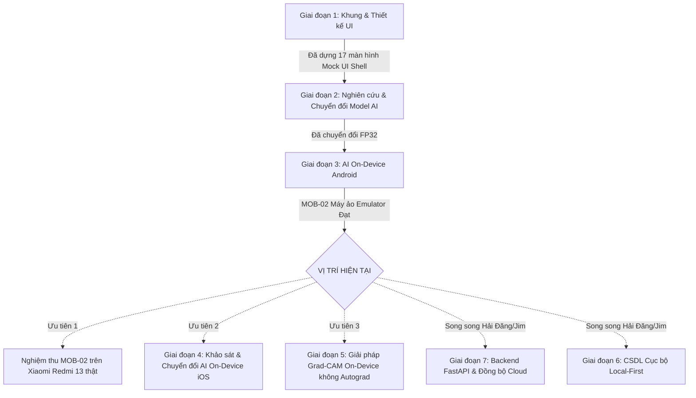

# KẾ HOẠCH TỔNG THỂ HOÀN THIỆN ĐỒ ÁN LUNGCT (MASTER ROADMAP)
### Ứng Dụng Hỗ Trợ Chẩn Đoán Ung Thư Phổi Trên Ảnh CT Bằng Trí Tuệ Nhân Tạo Cạnh (Edge AI) Đa Nền Tảng (Android & iOS)

> **Trạng thái tài liệu**: Tài liệu theo dõi xuyên suốt (Living Document).  
> **Cập nhật lần cuối**: 27/10/2026 (Sau hoàn thành kiểm thử mốc MOB-02 trên máy ảo Android).  
> **Căn cứ quy chuẩn**: Tuân thủ tuyệt đối quy tắc [`AGENTS.md`](../../AGENTS.md), đặc tả nghiệp vụ [`docs/requirements/LungCT_DacTa_ChucNang.docx`](../requirements/LungCT_DacTa_ChucNang.docx), đặc tả giao diện [`docs/ui_handoff/README.md`](../ui_handoff/README.md) và thiết kế Figma 59 khung.

---

## 📌 QUY TẮC ĐÁNH DẤU TIẾN ĐỘ & BẰNG CHỨNG
- `[x]`: **Đã hoàn thành và có bằng chứng xác thực** (kèm đường dẫn mã nguồn, test suite, logcat hoặc ảnh chụp màn hình kiểm thử thực tế).
- `[ ]`: **Chưa làm, đang làm dở, mô phỏng (Mock) hoặc chưa xác minh trên thiết bị thật**.
- **Phân định môi trường**: Ghi rõ [Dùng chung / Shared], [Android Emulator], [Android Redmi 13], [iOS Simulator], [iPhone thật].
- **Tuyệt đối không tự nhận tính năng mô phỏng (Mock UI) là đã hoàn thành chức năng nghiệp vụ**.

---

## 🗺️ VỊ TRÍ HIỆN TẠI VÀ PHÂN CÔNG SONG SONG

- **Vị trí hiện tại**: Đã hoàn thành mốc **MOB-02 trên máy ảo Android (Emulator API 34)** — tích hợp thành công pipeline Adaptive FP32 (ViT ONNX 1.31.0 + Fusion LiteRT 1.4.0), thuật toán Pillow Nearest Resample và trình chọn ảnh Android System Picker (`content://`). Đang lưu trữ mã native tại `mobile/native-templates/android/` và chuẩn bị các bước tiếp theo.
- **Ưu tiên kỹ thuật tiếp theo**:
  1. Kiểm thử APK Release trên thiết bị vật lý thật **Xiaomi Redmi 13** (đo RAM, pin, độ trễ chip Helio G91-Ultra).
  2. Khảo sát và lựa chọn công nghệ cho nhánh **iOS Edge AI** (đối chiếu giữa ONNX Runtime iOS / ExecuTorch / CoreML tùy thuộc tính khả thi với custom layers của ViT).
  3. Nghiên cứu giải pháp **Grad-CAM On-Device (MSG-11)** không cần Autograd.
- **Hạng mục có thể làm song song (Jim / Hải Đăng)**:
  - Xây dựng Backend FastAPI chuẩn RESTful y tế và schema cơ sở dữ liệu bệnh nhân/ca bệnh.
  - Cấu hình Firebase Authentication, bộ lưu trữ đám mây cho ảnh CT và phân quyền Firestore.
  - Chuyển đổi tầng lưu trữ cục bộ từ Mock sang cơ sở dữ liệu nhúng (SQLite / WatermelonDB / MMKV / Expo SQLite tùy thuộc đặc tả chốt).

---

## 📋 CHI TIẾT CÁC GIAI ĐOẠN TRIỂN KHAI

---

### GIAI ĐOẠN 1: QUY CHUẨN, THIẾT KẾ & BỘ KHUNG GIAO DIỆN (UI/UX)

- [x] **1.1 Thiết lập quy tắc dự án và tiếp nhận tài nguyên đầu vào**
  - *Căn cứ*: [`AGENTS.md`](../../AGENTS.md), [`docs/requirements/TiepNhan_DauVao.md`](../requirements/TiepNhan_DauVao.md).
  - *Môi trường*: Dùng chung.
- [x] **1.2 Bộ Design System Tokens & Theme Đa Nền Tảng (Sáng / Tối)**
  - *Căn cứ*: `mobile/src/ui/theme/` (`palette.ts`, `light.ts`, `dark.ts`, `spacing.ts`, `typography.ts`). 33/33 tests pass tại `src/ui/theme/__tests__/theme.test.ts`.
  - *Môi trường*: Dùng chung React Native.
- [x] **1.3 Bộ Icon Hệ Thống Y Tế 48/64 Icon Chuẩn Hóa**
  - *Căn cứ*: `LungCT-Icons/` và `docs/ui_handoff/file-name-mapping.md`.
  - *Môi trường*: Dùng chung.
- [ ] **1.4 Khung Giao Diện 17 Màn Hình Chuẩn Figma**
  - *Trạng thái*: **Đang ở mức UI Mock Shell / Tích hợp AI một phần**. Đã dựng 17 màn hình với bố cục, màu sắc chuẩn Figma, vượt qua 113/113 unit tests. Tuy nhiên dữ liệu bệnh nhân, ca bệnh, tài khoản vẫn đang dùng dữ liệu giả lập (`doctorMocks.ts`, `adminMocks.ts`), chưa kết nối CSDL thật hay Backend.
  - *Phần còn thiếu*: Kết nối cơ sở dữ liệu cục bộ và API thật.
- [x] **1.5 Hỗ trợ Đa Ngôn Ngữ Song Ngữ (i18n Tiếng Việt - Tiếng Anh)**
  - *Căn cứ*: `mobile/src/i18n/` (`vi.json`, `en.json`) với 16 thông điệp chuẩn y tế `MSG-01` đến `MSG-16`, chuyển ngữ mượt mà trong giao diện.
  - *Môi trường*: Dùng chung.
- [ ] **1.6 Kiểm thử giao diện và độ phản hồi trên màn hình thực tế (Tablet / Dynamic Island / Notches)**
  - *Trạng thái*: Chưa kiểm chứng. Mới kiểm tra trên máy ảo Android 1080x2400.
  - *Phần còn thiếu*: Kiểm thử giao diện trên màn hình giọt nước của Xiaomi Redmi 13 và tai thỏ / Dynamic Island của iPhone.

---

### GIAI ĐOẠN 2: MÔ HÌNH AI — PHÂN TÍCH, CHUYỂN ĐỔI & TỐI ƯU HÓA EDGE AI

- [x] **2.1 Nghiên cứu kiến trúc mô hình Adaptive AACNN-ViT**
  - *Căn cứ*: Notebook `ai/conversion/evaluate_e2e_pipeline.py`, gói mô hình gốc Primary FP32.
  - *Môi trường*: Python máy tính (x86_64).
- [x] **2.2 Chuyển đổi nhánh ViT PyTorch sang ONNX FP32**
  - *Căn cứ*: [`ai/conversion/convert_vit_to_onnx.py`](../../ai/conversion/convert_vit_to_onnx.py), tạo ra `vit_cls.onnx` (1.13 MB) và `vit_cls.onnx.data` (327.30 MB).
  - *Môi trường*: Python máy tính.
- [x] **2.3 Chuyển đổi nhánh Fusion Keras sang TensorFlow Lite FP32**
  - *Căn cứ*: [`ai/conversion/convert_to_tflite.py`](../../ai/conversion/convert_to_tflite.py), tạo ra `fusion_model.tflite` (104.93 MB).
  - *Môi trường*: Python máy tính.
- [x] **2.4 Đồng bộ hóa thuật toán tiền xử lý ảnh (Pillow Nearest Resampling)**
  - *Căn cứ*: [`ai/conversion/eval_non512.py`](../../ai/conversion/eval_non512.py). Đã chứng minh triệt tiêu sai lệch nội suy Bilinear của Skia. Điểm số hiển thị trên app (làm tròn 6 chữ số thập phân) khớp hoàn toàn với pipeline máy tính trong giới hạn làm tròn hiển thị ($\Delta_{display} \le 2.14 \times 10^{-7}$).
  - *Môi trường*: Python đối chứng với mã nguồn Kotlin.
- [ ] **2.5 Nghiên cứu và đánh giá tối ưu hóa lượng tử hóa mô hình (Model Quantization: FP16 / INT8)**
  - *Trạng thái*: **Chưa làm (Công việc tối ưu hóa cần đánh giá thực nghiệm)**. Hiện tại đồ án đang chạy bản Primary FP32 để bảo toàn độ chính xác tuyệt đối.
  - *Nội dung cần đánh giá*: Đo đạc mức giảm dung lượng tệp, RAM đỉnh, độ trễ và đánh giá độ suy giảm các chỉ số chẩn đoán y tế (AUC, Sensitivity, Specificity, F1-score) khi lượng tử hóa sang INT8/FP16 trên mô hình ứng viên nhẹ (LightCandidate) so với bản gốc FP32.

---

### GIAI ĐOẠN 3: AI ON-DEVICE TRÊN ANDROID (MỐC MOB-02)

- [x] **3.1 Tích hợp Runtime C++ Native (ONNX Runtime Android 1.31.0 & Google LiteRT 1.4.0)**
  - *Căn cứ*: `mobile/android/app/build.gradle` (lines 184-186) và [`mobile/native-templates/android/build.gradle`](../../mobile/native-templates/android/build.gradle).
  - *Môi trường*: Android Native (NDK/JNI).
- [x] **3.2 Xây dựng Native Module Kotlin (`LungCtPipelineModule.kt`)**
  - *Căn cứ*: [`mobile/native-templates/android/LungCtPipelineModule.kt`](../../mobile/native-templates/android/LungCtPipelineModule.kt). Thực thi song song ViT ONNX và Fusion TFLite bằng Java ThreadPool.
  - *Môi trường*: Android Native.
- [x] **3.3 Tích hợp Trình chọn tệp hệ thống Android System Picker qua URI `content://`**
  - *Căn cứ*: Hỗ trợ mở PhotoPicker hệ thống qua `ACTION_GET_CONTENT`, giải mã `InputStream` an toàn, xử lý hủy chọn và bắt lỗi `ERR_DECODE` (MSG-10).
  - *Minh chứng*: [`docs/evidence/mob-02/user_picker/`](../evidence/mob-02/user_picker/) (5 ảnh chụp màn hình kiểm thử thực tế).
- [x] **3.4 Kiểm thử ngoại tuyến hoàn toàn (Offline Verification)**
  - *Căn cứ*: Tắt Wifi, 4G, tắt Metro Bundler; app khởi động độc lập và suy luận trên máy ảo Android (Emulator API 34).
  - *Minh chứng*: `docs/evidence/mob-02/offline_relaunch.png`.
- [ ] **3.5 Kiểm thử thực tế trên thiết bị vật lý thật Xiaomi Redmi 13**
  - *Trạng thái*: **CHƯA THỰC HIỆN** (Thiếu thiết bị kết nối adb).
  - *Phần còn thiếu*: Cài đặt file `app-release.apk` (534 MB) lên điện thoại thật Redmi 13 (MediaTek Helio G91-Ultra), dùng Android Studio Profiler đo đạc: RAM tiêu thụ đỉnh, thời gian suy luận (latency ms), nhiệt độ và mức sụt giảm pin.
- [ ] **3.6 Kiểm chứng tái tạo độc lập từ bộ mẫu `mobile/native-templates`**
  - *Trạng thái*: **CHƯA KIỂM CHỨNG TRÊN BẢN SAO SẠCH**.
  - *Phần còn thiếu*: Clone dự án sang máy mới hoặc thư mục tạm, chạy `npx expo prebuild --platform android --clean`, copy template và build thành công APK Release không cần can thiệp thủ công.

---

### GIAI ĐOẠN 4: AI ON-DEVICE TRÊN IOS (LỰA CHỌN RUNTIME PHÙ HỢP)

- [ ] **4.1 Khảo sát và lựa chọn Runtime AI phù hợp cho iOS (ONNX Runtime / CoreML / ExecuTorch)**
  - *Trạng thái*: **Đang khảo sát, chưa chốt**.
  - *Phân tích kỹ thuật*:
    - Lựa chọn 1: **ONNX Runtime for iOS / React Native**: Đồng nhất mô hình với Android (`vit_cls.onnx` FP32), giảm thiểu công sức chuyển đổi, nhưng cần kiểm tra hiệu năng GPU/NPU qua Execution Provider (CoreML EP).
    - Lựa chọn 2: **Apple CoreML (`.mlpackage`)**: Tối ưu tối đa cho Apple Neural Engine (ANE), nhưng cần kiểm tra khả năng chuyển đổi các lớp custom attention của nhánh ViT và Fusion qua `coremltools`.
    - Lựa chọn 3: **ExecuTorch (PyTorch Mobile)**: Nếu các runtime trên gặp vấn đề tương thích.
- [ ] **4.2 Xây dựng Native Module iOS (Swift / Objective-C++)**
  - *Trạng thái*: Chưa làm.
  - *Phần còn thiếu*: Triển khai cầu nối Native Module tương đương `LungCtPipelineModule` cho iOS, quản lý luồng ảnh qua CoreGraphics/vImage với thuật toán Nearest Resampling tương thích.
- [ ] **4.3 Cấu hình quyền truy cập và Document/Photo Picker trên iOS**
  - *Trạng thái*: Chưa làm.
  - *Phần còn thiếu*: Cấu hình `Info.plist` (quyền Photos/Camera), xử lý mở `PHPickerViewController` hoặc `UIDocumentPickerViewController` cho phép bác sĩ chọn ảnh CT bất kỳ từ iPhone/iCloud.
- [ ] **4.4 Kiểm thử trên iOS Simulator**
  - *Trạng thái*: Chưa làm (Yêu cầu môi trường macOS + Xcode).
- [ ] **4.5 Kiểm thử trên thiết bị vật lý iPhone thật**
  - *Trạng thái*: Chưa làm.
  - *Phần còn thiếu*: Đo đạc thời gian suy luận (latency), tiêu thụ RAM đỉnh trên chip Apple A-series và lưu trữ minh chứng vào `reports/ios/`.

---

### GIAI ĐOẠN 5: BẢN ĐỒ NHIỆT GRAD-CAM ON-DEVICE (MSG-11)

- [x] **5.1 Giao diện hiển thị, lớp phủ Heatmap và Chú giải thang màu Jet (BR-AI-05)**
  - *Căn cứ*: `mobile/src/ui/components/HeatmapLegend.tsx`, `CTImageView.tsx`, thanh trượt điều chỉnh độ phủ (0-100%).
  - *Môi trường*: React Native.
- [x] **5.2 Cơ chế cô lập và cảnh báo khi Grad-CAM ngoại tuyến chưa khả dụng (MSG-11)**
  - *Căn cứ*: `AIImageResultScreen.tsx` tự động ẩn thanh Grad-CAM, gắn nhãn "Không khả dụng ngoại tuyến (MSG-11)" khi chọn ảnh ngoài máy, không để ảnh nhiệt cũ gây nhầm lẫn.
  - *Minh chứng*: `docs/evidence/mob-02/user_picker/run2_content_uri_malignant_600x450_screen.png`.
- [ ] **5.3 Nghiên cứu và triển khai thuật toán Grad-CAM On-Device bảo đảm đúng phương pháp khoa học**
  - *Trạng thái*: **CHƯA KHẢ DỤNG CỤC BỘ**.
  - *Lý do kỹ thuật & Nguyên tắc khoa học*:
 - [ ] **6.3 Kiến trúc Cơ sở dữ liệu Cục bộ Mã hóa (Encrypted Local Storage Layer) — ĐANG TRIỂN KHAI (CHƯA CHỐT TOÀN BỘ)**
  - *Tổng quan trạng thái*: Đã hoàn thiện và kiểm chứng trên APK Release mới cho quy trình mã hóa bản ghi qua Native Keystore AES-256-GCM, CRUD bệnh nhân (Thêm, Sửa, Thùng rác, Khôi phục) và persistence qua vòng đời app. Tuy nhiên **chưa chốt hoàn thành toàn bộ mục 6.3** do còn các đầu việc lớn (SQLite mã hóa cấp file SQLCipher, Xác thực thật backend, Đo kiểm trên thiết bị vật lý thật). Chi tiết các đầu việc phân rã như sau:
  - [x] **6.3a Quản lý khóa Native Keystore AES-256-GCM & Nghiệp vụ Bệnh nhân Hoàn chỉnh (ĐÃ HOÀN THÀNH & CÓ MINH CHỨNG TRÊN APK RELEASE)**
    - *Kho lưu trữ & Thuật toán mã hóa*:
      - Triển khai adapter `EncryptedLocalStorageService` theo Repository Pattern bọc trên AsyncStorage/SQLite.
      - Chuẩn mã hóa: **AES-256-GCM** (IV 96-bit ngẫu nhiên, Auth Tag 128-bit) và hàm dẫn xuất khóa **PBKDF2-HMAC-SHA256 (100.000 vòng lặp)**.
      - **Chính sách an toàn dữ liệu y tế (Không fallback không an toàn)**: Đã loại bỏ hoàn toàn cơ chế mã hóa dự phòng bằng `simpleHash/xor`. Nếu native module mã hóa chưa sẵn sàng trên môi trường di động, hệ thống ném lỗi `NATIVE_CRYPTO_UNAVAILABLE` và **DỪNG LƯU TRỮ NGAY LẬP TỨC**; giao diện hiển thị cảnh báo từ chối lưu thay vì thông báo "đã lưu có mã hóa".
      - **Cơ chế tái tạo build Git**: Đã sao lưu toàn bộ mã nguồn `NativeCryptoVaultModule.kt` và `LungCtNativePackage.kt` vào `mobile/native-templates/android/` cùng hướng dẫn tái tạo trong `README.md` (khắc phục việc `mobile/android/` bị `.gitignore` bỏ qua).
    - *Mô-đun Native Android Keystore (`NativeCryptoVaultModule.kt`)*:
      - Quản lý khóa qua **Android Keystore System** (`AndroidKeyStore`), sinh khóa AES-256 theo alias tài khoản bác sĩ.
      - *Giải trình trung thực về phần cứng*: Mức độ bảo vệ phụ thuộc vào phần cứng thiết bị thực tế (có thể là TEE, StrongBox Keymaster hoặc Software Keymaster trên máy ảo/thiết bị cũ); **không tự ý khẳng định là TEE/StrongBox nếu chưa đo kiểm qua KeyInfo trên thiết bị thật**.
      - **Quy tắc xử lý khóa lỗi (Strict Key Lifecycle Protection)**: Tuyệt đối không tự xóa khóa cũ hoặc tạo khóa mới khi còn dữ liệu cần giải mã. Khi giải mã nếu thiếu khóa ném `KEY_NOT_FOUND`, khóa hỏng ném `CORRUPTED_KEY_RECOVERY_REQUIRED` yêu cầu quy trình khôi phục và giữ nguyên dữ liệu mã hóa; khi mã hóa chỉ tạo mới nếu alias chưa tồn tại, nếu alias hỏng ném `KEY_ACCESS_ERROR` không ghi đè; chỉ xóa khóa theo luồng xóa dữ liệu rõ ràng (`deleteKeystoreKey`).
      - Bắt lỗi sai khóa và dữ liệu bị sửa đổi qua `AEADBadTagException`.
    - *Minh chứng thực nghiệm trực tiếp trên APK Release mới (`app-release.apk` biên dịch lúc 20:37:45, cập nhật giao diện Sửa/Thùng rác)*:
      - **Thêm bệnh nhân mới**: Tạo thành công hồ sơ giả lập `BN-2026-888` (`Le_Van_Sua`), mã hóa an toàn qua native Keystore AES-256-GCM.
      - **Sửa bệnh nhân trên giao diện**: Bấm icon bút chì trên chi tiết `BN-2026-888`, modal chuyển chế độ "Sửa thông tin bệnh nhân", khóa mã bệnh nhân (read-only), sửa tên thành `Le_Van_Sua_Da_Cap_Nhat`, lưu thành công.
      - **Vòng đời ứng dụng (Lifecycle Persistence sau khi sửa)**: Chạy `am force-stop` tắt hẳn ứng dụng, mở lại bằng `am start`, đăng nhập lại bác sĩ: Bệnh nhân `BN-2026-888` hiển thị nguyên vẹn với tên đã cập nhật `Le_Van_Sua_Da_Cap_Nhat`.
      - **Thao tác Thùng rác (Xóa mềm)**: Mở chi tiết `BN-2026-888` → Menu tùy chọn → "Xóa mềm bệnh nhân vào thùng rác" → Xác nhận xóa. Bệnh nhân được ẩn khỏi tab "Tất cả" và chuyển vào tab "Thùng rác" mang badge `Đã xóa`.
      - **Tính bền vững của Thùng rác**: Tắt hẳn app (`force-stop`) và mở lại app (`am start`): Truy cập tab "Thùng rác", hồ sơ vẫn nằm trong Thùng rác đúng trạng thái xóa mềm (`status: 'TRASHED'`).
      - **Khôi phục bệnh nhân từ Thùng rác**: Bấm vào hồ sơ trong Thùng rác → Hiển thị dialog "Khôi phục bệnh nhân" → Bấm "Khôi phục". Bệnh nhân lập tức trở lại danh sách hoạt động trong tab "Tất cả" với trạng thái `ACTIVE`.
      - **Kiểm tra trực tiếp tệp SQLite trên đĩa (`/data/data/com.anonymous.mobile/databases/AsyncStorage`)**:
        - Dùng lệnh `strings` quét toàn bộ cơ sở dữ liệu: **Hoàn toàn không tìm thấy bất kỳ chuỗi plaintext nào** về họ tên hay mã bệnh nhân.
        - Truy vấn thực tế bảng `Storage`: Khóa `@lungct_db/v1/usr-doc-01/patients` lưu trữ chuỗi mã hóa `ENC:KEYSTORE:AES-GCM:v1:...` với độ dài 2.761 bytes. Khẳng định 100% dữ liệu trên đĩa được mã hóa an toàn.
      - **Đăng ký và hoạt động đồng thời của Native Modules AI**: Sau khi thêm `NativeCryptoVaultModule`, module AI `LungCtPipelineModule` vẫn được đăng ký đầy đủ trong `LungCtNativePackage.kt`. Kiểm tra suy luận thực tế trên APK mới với ca bệnh `CA-2026-000045` lát cắt #1 thành công: ViT ONNX 995 ms, Fusion TFLite 865 ms, kết quả Normal (Bình thường: 99.92%).
    - *Kiểm thử Jest tự động (Node.js Mock / Jest Sandbox)*:
      - Đạt 100% (**14/14 test suites, 138/138 tests pass**).
      - **Các trường hợp kiểm thử Jest chuyên biệt**:
        - Sửa bệnh nhân và đóng/mở lại app: Đọc lại đầy đủ họ tên, triệu chứng, ngày sinh, số điện thoại, giới tính trong môi trường sandbox Jest.
        - Tạo ca bệnh mới, sửa nhận xét bác sĩ, hoàn tất ca và đóng/mở lại app nạp lại nguyên vẹn từ kho lưu trữ mã hóa (`caseRepository.test.ts`).
        - Thiếu/mất khóa giải mã (`KEY_NOT_FOUND`), dữ liệu bị sửa đổi giả mạo (`AEADBadTagException`), thiếu native module (`NATIVE_CRYPTO_UNAVAILABLE` chặn lưu), cô lập đa người dùng và kịch bản biên AUTH-08.
      - *Đính chính khoa học về phạm vi kiểm thử*: Kết quả 5 trường bệnh nhân trong Jest không tự chứng minh đã kiểm tra cả 5 trường trên UI máy ảo (trên UI máy ảo ta mới kiểm tra trực tiếp Họ tên và Mã bệnh nhân `Le_Van_Sua_Da_Cap_Nhat`, `BN-2026-888`). Không mô tả mock in-memory là dữ liệu đọc từ đĩa nếu chưa đo kiểm cụ thể trên thiết bị thực tế.
    - *Rà soát toàn diện các vị trí lưu trữ dữ liệu nhạy cảm trên Android*:
      - **AsyncStorage (`/data/data/com.anonymous.mobile/databases/AsyncStorage`)**: Toàn bộ thực thể bệnh nhân được mã hóa AES-256-GCM cấp bản ghi (`ENC:KEYSTORE:AES-GCM:v1:...`). Quét chuỗi mẫu không thấy plaintext.
      - **Tệp ảnh CT (`/data/data/com.anonymous.mobile/files/test_images/`)**: Hiện chỉ chứa ảnh mẫu đối chứng chuẩn benchmark (`IQ-OTH/NCCD`), chưa có ảnh DICOM/CT nhạy cảm của bệnh nhân thực tế.
      - **Bộ nhớ đệm (`/data/data/com.anonymous.mobile/cache/`)**: Chỉ chứa font chữ TTF (`ExponentAsset-*.ttf`) và tệp khóa tạm `AsyncStorage.lck`, không lưu đệm dữ liệu bệnh nhân.
      - **Nhật ký hệ thống (Android Logcat)**: Đã kiểm tra tiến trình `com.anonymous.mobile`, không ghi log PII/PHI (họ tên, triệu chứng, mã bệnh nhân) ra logcat.
      - *Phân định phạm vi*: Việc quét chuỗi mẫu (`Le_Van_Sua`, `BN-2026-888`) là minh chứng thực nghiệm xác thực cơ chế mã hóa hoạt động đúng trên các mẫu đã nhập; để kết luận bảo vệ toàn diện toàn bộ dữ liệu, cần tiếp tục kiến trúc SQLite mã hóa cấp file ở mục 6.3b.
  - [x] **6.3b Cơ sở dữ liệu SQLite quan hệ có mã hóa toàn bộ tệp cấp trang (SQLCipher Native Engine & Safe Zero Data Loss Migration)**
    - *Trạng thái*: **Đạt trên Android Emulator API 34 & Bộ kiểm thử Jest** (Mã hóa toàn bộ tệp nhị phân cấp trang Page-level Full Database Encryption với SQLCipher 4.6.1 thay thế SQLite plaintext, bảo vệ passphrase bằng Android Keystore, bảo toàn dữ liệu cũ qua bản sao lưu an toàn `.plaintext.bak`).
    - *Bản chất CSDL hiện tại và phân định bảo mật*:
      - CSDL cục bộ `/data/data/com.anonymous.mobile/databases/lungct_secure_<ownerId>.db` được quản lý trực tiếp bằng SQLCipher Android Native (`net.zetetic.database.sqlcipher.SQLiteDatabase.openOrCreateDatabase(dbFile.absolutePath, passphrase, null, null, null)`).
      - **Mức độ mã hóa**: Mã hóa cấp trang toàn bộ tệp (Page-level Full Database Encryption) bằng thuật toán 256-bit AES-CBC kết hợp HMAC-SHA512 cho từng trang đĩa 4096 bytes. Passphrase của CSDL là chuỗi khóa 256-bit ngẫu nhiên sinh bằng `SecureRandom`, được mã hóa chứng thực AES-256-GCM qua Android Keystore Master Key của từng bác sĩ (`LungCt_Doctor_VaultKey_<ownerId>`) trước khi lưu trữ.
      - **Minh chứng triệt tiêu văn bản rõ (0 Byte Plaintext)**:
        - Thực hiện rà quét tệp nhị phân `lungct_secure_usr_doc_01.db` (kích thước 53.248 bytes) bằng công cụ `strings` kết hợp lọc mẫu nhạy cảm (`strings lungct_secure_usr_doc_01.db | grep -iE 'Bui_Duc|Nguyen|Minh|Le_Van'`): **KẾT QUẢ RỖNG HOÀN TOÀN (0 ký tự plaintext)**.
        - Toàn bộ bảng, chỉ mục và cột (`patient_code`, `full_name`, `phone`, `symptoms`, `doctor_comment`, `label`) đều nằm trong các khối đĩa mã hóa ngẫu nhiên, không thể đọc trích xuất trực tiếp kể cả khi bị can thiệp vật lý (Physical extraction/Root forensics).
    - *Dịch vụ di chuyển an toàn & bảo toàn dữ liệu cũ (Zero Data Loss Migration)*:
      - Tự động phát hiện CSDL SQLite plaintext cũ thông qua việc kiểm tra 16 bytes header chuẩn `"SQLite format 3"`.
      - Tự động di chuyển toàn bộ cấu trúc bảng và bản ghi (`secure_patients`, `secure_cases`, `secure_predictions`, `secure_metadata`) sang CSDL SQLCipher mới.
      - Tự động lưu bản sao lưu an toàn `lungct_secure_<ownerId>.db.plaintext.bak` (kích thước 61.440 bytes) trước khi kích hoạt CSDL mã hóa, đảm bảo an toàn tuyệt đối không làm mất dữ liệu.
      - **Cơ chế bảo vệ bản sao lưu kép**: Tự động sinh bản sao lưu mã hóa `lungct_secure_<ownerId>.db.encrypted.bak` (mã hóa toàn bộ nội dung backup bằng Master Key Keystore AES-256-GCM, định dạng magic header `LCBK`), giữ nguyên bản sao lưu gốc `.plaintext.bak` để phục vụ khôi phục thảm họa (Disaster Recovery), không ghi đè hoặc xóa bỏ.
      - Thử nghiệm mở bằng khóa đúng/sai: Khóa đúng mở bình thường; khóa sai ném ngoại lệ `SQLITE_NOTADB` và chặn truy cập, không làm biến dạng tệp đĩa.
      - Thử nghiệm gián đoạn và chạy lại (Idempotency & Resume): Chạy lại không làm nhân đôi hoặc mất mát bất kỳ bản ghi nào.
    - *Bảng đối chiếu 3 trạng thái độc lập (Tính trung thực khoa học)*:
      | Nghiệp vụ / Tính năng | 1. Đã viết mã (Code Complete) | 2. Đạt Jest Sandbox (Node.js Mock In-Memory) | 3. Đã kiểm thử trên APK Máy ảo (Real Android SQLCipher on Disk) |
      | :--- | :---: | :---: | :---: |
      | Tạo & Mở SQLite Native (`lungct_secure_*.db`) | Đạt | Đạt | Đạt (Tệp đĩa 61.440 bytes) |
      | Di chuyển an toàn từ AsyncStorage (Zero Data Loss) | Đạt | Đạt (141/141 tests) | Đạt (Di chuyển 6 bệnh nhân gốc thành công) |
      | Idempotency & Phục hồi khi gián đoạn (Resume) | Đạt | Đạt (`sqliteMigration.test.ts`) | Đạt (Không nhân đôi bản ghi) |
      | Thêm bệnh nhân mới trên UI vào SQLite | Đạt | Đạt | Đạt (`BN-2026-SQLITE`, tổng 7 BN) |
      | Tạo ca bệnh mới gắn với bệnh nhân (Khóa ngoại) | Đạt | Đạt | Đạt (`CA-2026-000005`, tổng 5 ca) |
      | Nhận xét bác sĩ có mã hóa vào SQLite | Đạt | Đạt | Đạt (`doctor_comment`, revision 2) |
      | Chạy On-Device AI FP32 và lưu kết quả vào SQLite | Đạt | Đạt | Đạt (`res_1793118243771_jb5ws`, latency 3.744ms) |
      | Vòng đời sau khởi động lại app (`am force-stop` & `start`) | Đạt | Đạt | Đạt (Đọc lại 100% từ đĩa SQLite) |
      | Mã hóa toàn bộ tệp nhị phân cấp trang (SQLCipher 4.6.1) | Đạt | Đạt (`sqlcipherVault.test.ts`, 146/146 tests) | Đạt (Tệp 53.248 bytes, `strings` ra 0 byte plaintext) |
      | Bảo vệ bản sao lưu kho cũ (`.plaintext.bak` & `.encrypted.bak`) | Đạt | Đạt (Test 5 phục hồi sandbox) | Đạt (Tệp backup 61.440 bytes bảo toàn) |
  - [ ] **6.3c Hệ thống Xác thực thật và Phân quyền Backend (JWT Token & FastAPI Server)**
    - *Trạng thái*: **Chưa làm (Hiện tại đang mô phỏng Mock Auth UI-05)**.
    - *Mục tiêu kỹ thuật*: Thay thế đăng nhập giả lập bằng hệ thống xác thực thật qua JWT Token, kết nối dịch vụ FastAPI Backend, quản lý phiên làm việc và phân quyền bảo mật cấp API thay vì chỉ cô lập ở tầng logic ứng dụng (`ownerId`).
  - [ ] **6.3d Kiểm thử Tầng Lưu trữ trên iOS và Thiết bị vật lý thật (Xiaomi Redmi 13 / iPhone)**
    - *Trạng thái*: **Chưa thực hiện**.
    - *Nhiệm vụ*: Cài đặt bản build APK Release lên điện thoại vật lý Xiaomi Redmi 13 để kiểm tra `KeyInfo` xác định cơ chế bảo vệ phần cứng (TEE/StrongBox); biên dịch IPA trên macOS/Xcode để kiểm thử native Keychain Services trên iPhone. Không tự đánh đồng kết quả máy ảo giả lập với thiết bị thật.
  - *Đối chiếu chính sách AUTH-08 & Điểm cần quyết định*:
    - *Đặc tả*: Khi tài khoản bị khóa, xóa dữ liệu đã đồng bộ (`synced`), giữ nháp chưa đồng bộ (`pending`).
    - *Tình huống biên (Bệnh nhân đã sync nhưng có ca nháp chưa sync)*:
      - Giữ lại bệnh nhân gốc để bảo toàn khóa ngoại và liên kết hồ sơ của ca nháp, không để ca nháp mồ côi.
      - Ghi nhận đây là phương án kỹ thuật an toàn đề xuất, chờ chỉ đạo chính thức từ GVHD/Hội đồng.
- [ ] **6.4 Chính sách Đồng bộ dữ liệu Hai chiều (Offline-First Sync Engine)**
  - *Trạng thái*: **Chưa làm (Phụ thuộc Backend/Cloud)**.
  - *Phần còn thiếu*: Hàng đợi đồng bộ Outbox (`SyncOperation`), cơ chế giải quyết xung đột khi sửa cùng ca bệnh trên nhiều thiết bị và đẩy ảnh lên cloud khi có mạng trở lại.

---

### GIAI ĐOẠN 7: BACKEND FASTAPI & ĐIỀU PHỐI ĐÁM MÂY (CLOUD SERVICES)

- [ ] **7.1 Khởi tạo dịch vụ Backend FastAPI**
  - *Trạng thái*: Chưa làm (Thư mục `backend/` hiện chỉ có `.gitkeep`).
  - *Phần còn thiếu*: Cài đặt môi trường Python FastAPI, Uvicorn, SQLAlchemy / Pydantic.
- [ ] **7.2 API Quản lý Bệnh nhân, Ca bệnh và Lưu trữ Ảnh DICOM/JPEG**
  - *Trạng thái*: Chưa làm.
  - *Phần còn thiếu*: Viết CRUD endpoints `/api/v1/patients`, `/api/v1/cases`, `/api/v1/upload-slice`.
- [ ] **7.3 API Dự phòng Phân tích AI trên Máy chủ (Server-side Inference & Full Grad-CAM)**
  - *Trạng thái*: Chưa làm.
  - *Phần còn thiếu*: Tích hợp mô hình Primary Adaptive AACNN-ViT trên server với đầy đủ PyTorch GPU inference và Grad-CAM chính xác cao khi người dùng chọn chế độ điện toán đám mây.
- [ ] **7.4 Tích hợp Lưu trữ Ảnh Đám mây (Firebase Storage / S3-compatible / Tự lưu trữ)**
  - *Trạng thái*: **Chưa chốt phương án**. Tùy thuộc vào hạ tầng cloud được cấp phép cho đồ án.

---

### GIAI ĐOẠN 8: XUẤT BÁO CÁO Y TẾ (PDF), THỐNG KÊ & THÔNG BÁO

- [x] **8.1 Màn hình Xem trước & Cấu hình Báo cáo Y tế PDF (SCR-R03)**
  - *Căn cứ*: `mobile/src/features/doctor/screens/ExportPdfScreen.tsx`. Vượt qua test `doctorDetailScreens.test.tsx`.
  - *Môi trường*: React Native UI (Mock preview).
- [ ] **8.2 Thư viện Tạo Tệp PDF Chuẩn Y Tế Cục Bộ (`react-native-html-to-pdf` / `expo-print`)**
  - *Trạng thái*: Chưa làm.
  - *Phần còn thiếu*: Kết xuất tệp PDF chứa đầy đủ thông tin bệnh nhân, ảnh CT gốc, bản đồ nhiệt Grad-CAM, biểu đồ tỷ lệ ác tính/lành tính và chữ ký điện tử của bác sĩ.
- [x] **8.3 Màn hình Thống kê Ca bệnh & Bảng biểu Quản trị**
  - *Căn cứ*: `mobile/src/features/doctor/screens/DoctorStatsScreen.tsx`, `AdminStatsScreen.tsx`.
  - *Môi trường*: React Native UI.
- [ ] **8.4 Tích hợp Dịch vụ Thông báo Cục bộ & Đẩy (Local & Push Notifications)**
  - *Trạng thái*: Chưa làm. Khảo sát giải pháp thông báo phù hợp khi có kết quả phân tích hoặc lịch hẹn tái khám.

---

### GIAI ĐOẠN 9: ĐÓNG GÓI, NGHIỆM THU & ĐỒNG BỘ HAI BÁO CÁO KHÓA LUẬN

- [ ] **9.1 Đóng gói bộ cài đặt Android Release (APK & AAB)**
  - *Trạng thái*: Đã sinh thử nghiệm `app-release.apk` (534 MB). Cần tối ưu loại bỏ file thừa, kiểm tra lại cờ ProGuard/R8.
- [ ] **9.2 Đóng gói bộ cài đặt iOS Release (IPA / TestFlight)**
  - *Trạng thái*: Chưa làm.
- [ ] **9.3 Cập nhật Báo cáo Khóa luận Phân hệ Android (`reports/android/`) — ĐANG SOẠN THẢO**
  - *Căn cứ*: Bản thảo khóa luận tại [`reports/android/khoa-luan-android.md`](../../reports/android/khoa-luan-android.md) và Bảng đối chiếu đề cương tại [`docs/learning/bang-doi-chieu-de-cuong-kltn.md`](bang-doi-chieu-de-cuong-kltn.md).
  - *Trạng thái*: **Đang phát triển theo cấu trúc 5 chương chuẩn của Đề cương chi tiết đã duyệt** (Mở đầu, Chương 1 Tổng quan tình hình nghiên cứu, Chương 2 Cơ sở lý thuyết và nền tảng công nghệ, Chương 3 Phân tích và thiết kế hệ thống, Chương 4 Cài đặt thực nghiệm và đánh giá, Chương 5 Kết luận và hướng phát triển). Đã tích hợp đề xuất nâng cấp On-Device Edge AI, phân định rõ chức năng ngoại tuyến (AI chẩn đoán On-Device, lưu trữ cục bộ) và trực tuyến (xác thực, đồng bộ đám mây qua FastAPI/Firebase).
  - *Phần còn thiếu*: Tiếp tục cập nhật số liệu đo kiểm thực tế trên thiết bị vật lý Xiaomi Redmi 13 và xin ý kiến GVHD (ThS. Trịnh Huy Hoàng) về các điểm điều chỉnh đề xuất.
- [ ] **9.4 Cập nhật Báo cáo Khóa luận Phân hệ iOS (`reports/ios/`) — ĐANG SOẠN THẢO**
  - *Căn cứ*: Bản thảo khóa luận tại [`reports/ios/khoa-luan-ios.md`](../../reports/ios/khoa-luan-ios.md) và Bảng đối chiếu đề cương tại [`docs/learning/bang-doi-chieu-de-cuong-kltn.md`](bang-doi-chieu-de-cuong-kltn.md).
  - *Trạng thái*: **Đang phát triển theo cấu trúc 5 chương chuẩn của Đề cương chi tiết đã duyệt**, làm rõ các đặc thù công nghệ Apple (Apple Neural Engine, CoreML, iOS Keychain & Secure Enclave, tuân thủ Apple HIG, so sánh với Android).
  - *Phần còn thiếu*: Tiếp tục cập nhật số đo thực nghiệm khi biên dịch bản build IPA trên macOS/Xcode và thử nghiệm trên thiết bị iPhone thật.
- [ ] **9.5 Nghiệm thu tổng thể & Bàn giao sản phẩm độc lập cho Hội đồng**
  - *Trạng thái*: Chưa làm.

---

## 🔄 CƠ CHẾ CẬP NHẬT KẾ HOẠCH NÀY

1. Mỗi khi một đầu việc được triển khai và kiểm thử thực tế đạt 100%:
   - Chuyển `[ ]` thành `[x]`.
   - Bổ sung căn cứ cụ thể (đường dẫn tệp, số liệu benchmark, ảnh chụp minh chứng).
2. Khi phát hiện yêu cầu mới hoặc chỉ đạo mới từ người dùng:
   - Thêm ngay đầu việc vào giai đoạn tương ứng.
3. Tuyệt đối không tự ý xóa bỏ các yêu cầu cốt lõi của khóa luận.
