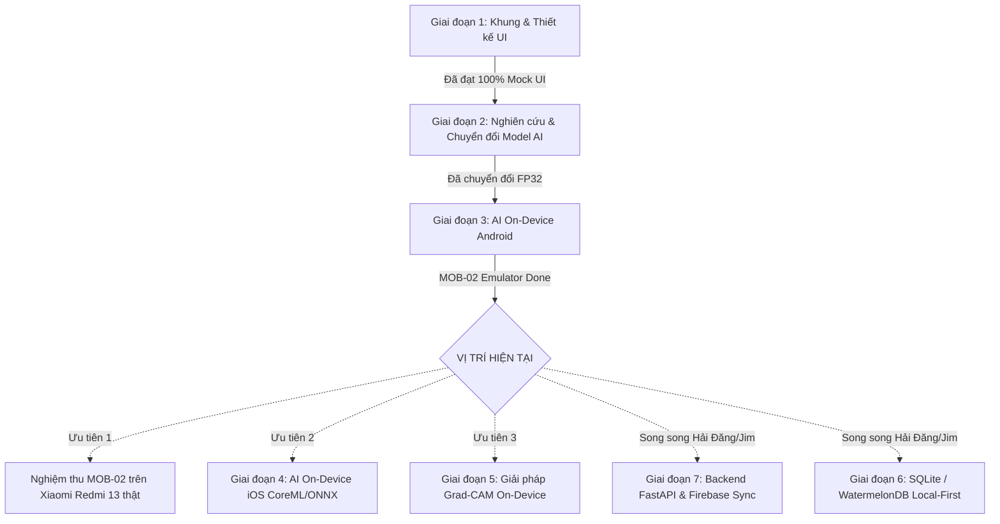

# KẾ HOẠCH TỔNG THỂ HOÀN THIỆN ĐỒ ÁN LUNGCT (MASTER ROADMAP)
### Ứng Dụng Hỗ Trợ Chẩn Đoán Ung Thư Phổi Trên Ảnh CT Bằng Trí Tuệ Nhân Tạo Cạnh (Edge AI) Đa Nền Tảng (Android & iOS)

> **Trạng thái tài liệu**: Tài liệu theo dõi xuyên suốt (Living Document).  
> **Cập nhật lần cuối**: 27/10/2026 (Sau hoàn thành kiểm thử mốc MOB-02 trên máy ảo Android).  
> **Căn cứ quy chuẩn**: Tuân thủ tuyệt đối quy tắc [`AGENTS.md`](../../AGENTS.md), đặc tả nghiệp vụ [`docs/requirements/LungCT_DacTa_ChucNang.docx`](../requirements/LungCT_DacTa_ChucNang.docx), đặc tả giao diện [`docs/ui_handoff/README.md`](../ui_handoff/README.md) và thiết kế Figma 59 khung.

---

## 📌 QUY TẮC ĐÁNH DẤU TIẾN ĐỘ & BẰNG CHỨNG
- `[x]`: **Đã hoàn thành và có bằng chứng xác thực** (kèm đường dẫn mã nguồn, test suite, logcat hoặc ảnh chụp màn hình kiểm thử thực tế).
- `[ ]`: **Chưa làm, đang làm dở, mô phỏng (Mock) hoặc chưa xác minh trên thiết bị thật**.
- **Phân định môi trường**: Ghi rõ [Dùng chung / Shared], [Android Emulator], [Android Redmi 13], [iOS Simulator], [iPhone thật].
- **Tuyệt đối không tự nhận tính năng mô phỏng (Mock UI) là đã hoàn thành chức năng nghiệp vụ**.

---

## 🗺️ VỊ TRÍ HIỆN TẠI VÀ PHÂN CÔNG SONG SONG

- **Vị trí hiện tại**: Đã hoàn thành mốc **MOB-02 trên máy ảo Android (Emulator API 34)** — tích hợp thành công pipeline Adaptive FP32 (ViT ONNX 1.31.0 + Fusion LiteRT 1.4.0), thuật toán Pillow Nearest Resample và trình chọn ảnh Android System Picker (`content://`). Đang chuẩn bị commit Git và chuyển giao sang thiết bị thật.
- **Ưu tiên kỹ thuật tiếp theo**:
  1. Kiểm thử APK Release trên thiết bị vật lý thật **Xiaomi Redmi 13** (đo RAM, pin, độ trễ chip Helio G91-Ultra).
  2. Khởi động nhánh **iOS CoreML / ONNX Runtime** trên Xcode / iPhone thật.
  3. Nghiên cứu giải pháp **Grad-CAM On-Device (MSG-11)** không cần Autograd.
- **Hạng mục có thể làm song song (Jim / Hải Đăng)**:
  - Xây dựng Backend FastAPI chuẩn RESTful y tế và schema cơ sở dữ liệu bệnh nhân/ca bệnh.
  - Cấu hình Firebase Authentication, Firebase Storage cho ảnh CT và Firestore rules.
  - Chuyển đổi tầng lưu trữ cục bộ từ Mock sang SQLite/WatermelonDB theo mô hình Local-First.

---

## 📋 CHI TIẾT CÁC GIAI ĐOẠN TRIỂN KHAI

---

### GIAI ĐOẠN 1: QUY CHUẨN, THIẾT KẾ & BỘ KHUNG GIAO DIỆN (UI/UX)

- [x] **1.1 Thiết lập quy tắc dự án và tiếp nhận tài nguyên đầu vào**
  - *Căn cứ*: [`AGENTS.md`](../../AGENTS.md), [`docs/requirements/TiepNhan_DauVao.md`](../requirements/TiepNhan_DauVao.md).
  - *Môi trường*: Dùng chung.
- [x] **1.2 Bộ Design System Tokens & Theme Đa Nền Tảng (Sáng / Tối)**
  - *Căn cứ*: `mobile/src/ui/theme/` (`palette.ts`, `light.ts`, `dark.ts`, `spacing.ts`, `typography.ts`). 32/32 tests pass tại `src/ui/theme/__tests__/theme.test.ts`.
  - *Môi trường*: Dùng chung React Native.
- [x] **1.3 Bộ Icon Hệ Thống Y Tế 48/64 Icon Chuẩn Hóa**
  - *Căn cứ*: `LungCT-Icons/` và `docs/ui_handoff/file-name-mapping.md`.
  - *Môi trường*: Dùng chung.
- [x] **1.4 Khung Giao Diện 17 Màn Hình Chuẩn Figma (Mock Data)**
  - *Căn cứ*: Toàn bộ 17 màn hình (Bác sĩ, Quản trị viên, Cài đặt, Đăng nhập) tại `mobile/src/features/`. Vượt qua 113/113 unit tests.
  - *Môi trường*: Dùng chung / Android & iOS UI Shell.
- [x] **1.5 Hỗ trợ Đa Ngôn Ngữ Song Ngữ (i18n Tiếng Việt - Tiếng Anh)**
  - *Căn cứ*: `mobile/src/i18n/` (`vi.json`, `en.json`) với 16 thông điệp chuẩn y tế `MSG-01` đến `MSG-16`.
  - *Môi trường*: Dùng chung.
- [ ] **1.6 Kiểm thử giao diện và độ phản hồi trên màn hình thực tế (Tablet / Dynamic Island / Notches)**
  - *Trạng thái*: Chưa kiểm chứng. Mới kiểm tra trên máy ảo Android 1080x2400.
  - *Phần còn thiếu*: Kiểm thử giao diện trên màn hình giọt nước của Xiaomi Redmi 13 và tai thỏ / Dynamic Island của iPhone.

---

### GIAI ĐOẠN 2: MÔ HÌNH AI — PHÂN TÍCH, CHUYỂN ĐỔI & TỐI ƯU HÓA EDGE AI

- [x] **2.1 Nghiên cứu kiến trúc mô hình Adaptive AACNN-ViT**
  - *Căn cứ*: Notebook `ai/conversion/evaluate_e2e_pipeline.py`, gói mô hình gốc Primary FP32.
  - *Môi trường*: Python máy tính (x86_64).
- [x] **2.2 Chuyển đổi nhánh ViT PyTorch sang ONNX FP32**
  - *Căn cứ*: [`ai/conversion/convert_vit_to_onnx.py`](../../ai/conversion/convert_vit_to_onnx.py), tạo ra `vit_cls.onnx` (1.13 MB) và `vit_cls.onnx.data` (327.30 MB).
  - *Môi trường*: Python máy tính.
- [x] **2.3 Chuyển đổi nhánh Fusion Keras sang TensorFlow Lite FP32**
  - *Căn cứ*: [`ai/conversion/convert_to_tflite.py`](../../ai/conversion/convert_to_tflite.py), tạo ra `fusion_model.tflite` (104.93 MB).
  - *Môi trường*: Python máy tính.
- [x] **2.4 Đồng bộ hóa thuật toán tiền xử lý ảnh (Pillow Nearest Resampling)**
  - *Căn cứ*: [`ai/conversion/eval_non512.py`](../../ai/conversion/eval_non512.py). Đã chứng minh triệt tiêu sai lệch nội suy Bilinear, đưa sai lệch số học về mức $\le 2.14 \times 10^{-7}$.
  - *Môi trường*: Python đối chứng với mã nguồn Kotlin.
- [ ] **2.5 Đánh giá và so sánh mô hình ứng viên nhẹ (LightCandidate FP16 / INT8)**
  - *Trạng thái*: Chưa làm. Hiện tại đồ án đang chạy bản Primary FP32 để đảm bảo độ chính xác tuyệt đối.
  - *Phần còn thiếu*: Lượng hóa dung lượng, RAM và độ suy giảm AUC/F1-score khi lượng tử hóa sang INT8/FP16.

---

### GIAI ĐOẠN 3: AI ON-DEVICE TRÊN ANDROID (MỐC MOB-02)

- [x] **3.1 Tích hợp Runtime C++ Native (ONNX Runtime Android 1.31.0 & Google LiteRT 1.4.0)**
  - *Căn cứ*: `mobile/android/app/build.gradle` (lines 184-186) và [`mobile/native-templates/android/build.gradle`](../../mobile/native-templates/android/build.gradle).
  - *Môi trường*: Android Native (NDK/JNI).
- [x] **3.2 Xây dựng Native Module Kotlin (`LungCtPipelineModule.kt`)**
  - *Căn cứ*: [`mobile/native-templates/android/LungCtPipelineModule.kt`](../../mobile/native-templates/android/LungCtPipelineModule.kt). Thực thi song song ViT ONNX và Fusion TFLite bằng Java ThreadPool.
  - *Môi trường*: Android Native.
- [x] **3.3 Tích hợp Trình chọn tệp hệ thống Android System Picker qua URI `content://`**
  - *Căn cứ*: Hỗ trợ mở PhotoPicker hệ thống qua `ACTION_GET_CONTENT`, giải mã `InputStream` an toàn, xử lý hủy chọn và bắt lỗi `ERR_DECODE` (MSG-10).
  - *Minh chứng*: [`docs/evidence/mob-02/user_picker/`](../evidence/mob-02/user_picker/) (5 ảnh chụp màn hình kiểm thử thực tế).
- [x] **3.4 Kiểm thử ngoại tuyến hoàn toàn (Offline Verification)**
  - *Căn cứ*: Tắt Wifi, 4G, tắt Metro Bundler; app khởi động độc lập và suy luận trên máy ảo Android (Emulator API 34).
  - *Minh chứng*: `docs/evidence/mob-02/offline_relaunch.png`.
- [ ] **3.5 Kiểm thử thực tế trên thiết bị vật lý thật Xiaomi Redmi 13**
  - *Trạng thái*: **CHƯA THỰC HIỆN** (Thiếu thiết bị kết nối adb).
  - *Phần còn thiếu*: Cài đặt file `app-release.apk` (534 MB) lên điện thoại thật Redmi 13 (MediaTek Helio G91-Ultra), dùng Android Studio Profiler đo đạc: RAM tiêu thụ đỉnh, thời gian suy luận (latency ms), nhiệt độ và mức sụt giảm pin.
- [ ] **3.6 Kiểm chứng tái tạo độc lập từ bộ mẫu `mobile/native-templates`**
  - *Trạng thái*: **CHƯA KIỂM CHỨNG TRÊN BẢN SAO SẠCH**.
  - *Phần còn thiếu*: Clone dự án sang máy mới hoặc thư mục tạm, chạy `npx expo prebuild --platform android --clean`, copy template và build thành công APK Release không cần can thiệp thủ công.

---

### GIAI ĐOẠN 4: AI ON-DEVICE TRÊN IOS (COREML / ONNX RUNTIME)

- [ ] **4.1 Chuyển đổi mô hình Adaptive sang định dạng Apple CoreML (`.mlpackage`)**
  - *Trạng thái*: Chưa làm.
  - *Phần còn thiếu*: Chuyển đổi nhánh ViT PyTorch bằng `coremltools` và nhánh Fusion Keras sang CoreML; kiểm tra tính tương thích của custom attention layers trên Apple Neural Engine (ANE).
- [ ] **4.2 Xây dựng Native Module iOS (Swift / Objective-C++)**
  - *Trạng thái*: Chưa làm.
  - *Phần còn thiếu*: Triển khai cầu nối Native Module tương đương `LungCtPipelineModule` cho nền tảng iOS, quản lý luồng ảnh qua CoreGraphics/vImage.
- [ ] **4.3 Cấu hình CocoaPods và quyền truy cập Photos / Document Picker trên iOS**
  - *Trạng thái*: Chưa làm.
  - *Phần còn thiếu*: Cấu hình `Info.plist`, xử lý quyền truy cập bộ sưu tập ảnh và chọn tệp qua `UIDocumentPickerViewController`.
- [ ] **4.4 Kiểm thử trên iOS Simulator**
  - *Trạng thái*: Chưa làm (Yêu cầu môi trường macOS + Xcode).
- [ ] **4.5 Kiểm thử trên thiết bị vật lý iPhone thật**
  - *Trạng thái*: Chưa làm.
  - *Phần còn thiếu*: Đo đạc thời gian suy luận, tiêu thụ RAM đỉnh trên A-series chip và ghi nhận minh chứng vào `reports/ios/`.

---

### GIAI ĐOẠN 5: BẢN ĐỒ NHIỆT GRAD-CAM ON-DEVICE (MSG-11)

- [x] **5.1 Giao diện hiển thị, lớp phủ Heatmap và Chú giải thang màu Jet (BR-AI-05)**
  - *Căn cứ*: `mobile/src/ui/components/HeatmapLegend.tsx`, `CTImageView.tsx`, thanh trượt điều chỉnh độ phủ (0-100%).
  - *Môi trường*: React Native.
- [x] **5.2 Cơ chế cô lập và cảnh báo khi Grad-CAM ngoại tuyến chưa khả dụng (MSG-11)**
  - *Căn cứ*: `AIImageResultScreen.tsx` tự động ẩn thanh Grad-CAM, gắn nhãn "Không khả dụng ngoại tuyến (MSG-11)" khi chọn ảnh ngoài máy, không để ảnh nhiệt cũ gây nhầm lẫn.
  - *Minh chứng*: `docs/evidence/mob-02/user_picker/run2_content_uri_malignant_600x450_screen.png`.
- [ ] **5.3 Nghiên cứu và triển khai thuật toán Grad-CAM On-Device không phụ thuộc Autograd**
  - *Trạng thái*: **CHƯA KHẢ DỤNG CỤC BỘ**.
  - *Lý do kỹ thuật*: ONNX Runtime và TensorFlow Lite trên di động chỉ hỗ trợ Forward-pass (không có đồ thị đạo hàm ngược Autograd để tính Gradient $\frac{\partial Y^c}{\partial A^k}$).
  - *Giải pháp cần làm*:
    - Phương án A (Activation Subgraph / Trọng số tĩnh): Xuất mô hình phụ trích xuất trực tiếp Feature Maps và nhân với vector trọng số phân loại cố định (Class Activation Mapping - CAM).
    - Phương án B (Tạo Graph đạo hàm sẵn): Nối sẵn các phép tính Gradient vào graph ONNX/TFLite lúc xuất từ PyTorch/TensorFlow.
- [ ] **5.4 Đối chiếu ma trận bản đồ nhiệt giữa Python Colab và Thiết bị di động**
  - *Trạng thái*: Chưa làm. Cần so sánh sai lệch pixel-by-pixel (MSE, SSIM) giữa heatmaps trên máy tính và điện thoại.

---

### GIAI ĐOẠN 6: XÁC THỰC, PHÂN QUYỀN & LƯU TRỮ CỤC BỘ (LOCAL-FIRST)

- [x] **6.1 Luồng giao diện Đăng nhập, Quên mật khẩu & Chuyển đổi Vai trò (Bác sĩ / Quản trị)**
  - *Căn cứ*: `mobile/src/features/auth/screens/SignInScreen.tsx`, `RoleSwitchScreen.tsx`. Vượt qua test suite `authScreens.test.tsx`.
  - *Môi trường*: React Native UI (Mock Storage).
- [ ] **6.2 Tích hợp Firebase Authentication thực tế (Email/Password, Token Refresh)**
  - *Trạng thái*: Chưa làm. Hiện đang dùng mock auth thông qua `AsyncStorage`.
  - *Phần còn thiếu*: Cài đặt `@react-native-firebase/auth`, cấu hình `google-services.json` (Android) và `GoogleService-Info.plist` (iOS).
- [ ] **6.3 Kiến trúc Cơ sở dữ liệu Cục bộ (SQLite / WatermelonDB / MMKV)**
  - *Trạng thái*: Chưa làm. Dữ liệu bệnh nhân và ca bệnh hiện đang nạp tĩnh từ `doctorMocks.ts`.
  - *Phần còn thiếu*: Thiết kế schema bảng SQLite: `patients`, `cases`, `ct_slices`, `ai_predictions`. Đảm bảo hoạt động trơn tru khi offline hoàn toàn.
- [ ] **6.4 Chính sách Đồng bộ dữ liệu Hai chiều (Offline-First Sync Engine)**
  - *Trạng thái*: Chưa làm.
  - *Phần còn thiếu*: Cơ chế đánh dấu trạng thái đồng bộ (`sync_status: 'synced' | 'pending' | 'conflict'`), xử lý hàng đợi đẩy lên cloud khi có mạng trở lại.

---

### GIAI ĐOẠN 7: BACKEND FASTAPI & ĐIỀU PHỐI ĐÁM MÂY (CLOUD SERVICES)

- [ ] **7.1 Khởi tạo dịch vụ Backend FastAPI**
  - *Trạng thái*: Chưa làm (Thư mục `backend/` hiện chỉ có `.gitkeep`).
  - *Phần còn thiếu*: Cài đặt môi trường Python FastAPI, Uvicorn, SQLAlchemy / Pydantic.
- [ ] **7.2 API Quản lý Bệnh nhân, Ca bệnh và Lưu trữ Ảnh DICOM/JPEG**
  - *Trạng thái*: Chưa làm.
  - *Phần còn thiếu*: Viết CRUD endpoints `/api/v1/patients`, `/api/v1/cases`, `/api/v1/upload-slice`.
- [ ] **7.3 API Dự phòng Phân tích AI trên Máy chủ (Server-side Inference & Full Grad-CAM)**
  - *Trạng thái*: Chưa làm.
  - *Phần còn thiếu*: Tích hợp mô hình Primary Adaptive AACNN-ViT trên server với đầy đủ PyTorch GPU inference và Grad-CAM chính xác cao khi người dùng chọn chế độ điện toán đám mây.
- [ ] **7.4 Tích hợp Lưu trữ Đám mây Firebase Cloud Storage / S3**
  - *Trạng thái*: Chưa làm.

---

### GIAI ĐOẠN 8: XUẤT BÁO CÁO Y TẾ (PDF), THỐNG KÊ & THÔNG BÁO

- [x] **8.1 Màn hình Xem trước & Cấu hình Báo cáo Y tế PDF (SCR-R03)**
  - *Căn cứ*: `mobile/src/features/doctor/screens/ExportPdfScreen.tsx`. Vượt qua test `doctorDetailScreens.test.tsx`.
  - *Môi trường*: React Native UI (Mock preview).
- [ ] **8.2 Thư viện Tạo Tệp PDF Chuẩn Y Tế Cục Bộ (`react-native-html-to-pdf` / `expo-print`)**
  - *Trạng thái*: Chưa làm.
  - *Phần còn thiếu*: Kết xuất tệp PDF chứa đầy đủ thông tin bệnh nhân, ảnh CT gốc, bản đồ nhiệt Grad-CAM, biểu đồ tỷ lệ ác tính/lành tính và chữ ký điện tử của bác sĩ.
- [x] **8.3 Màn hình Thống kê Ca bệnh & Bảng biểu Quản trị**
  - *Căn cứ*: `mobile/src/features/doctor/screens/DoctorStatsScreen.tsx`, `AdminStatsScreen.tsx`.
  - *Môi trường*: React Native UI.
- [ ] **8.4 Tích hợp Dịch vụ Thông báo Cục bộ & Đẩy (Local & Push Notifications - FCM)**
  - *Trạng thái*: Chưa làm.

---

### GIAI ĐOẠN 9: ĐÓNG GÓI, NGHIỆM THU & ĐỒNG BỘ HAI BÁO CÁO KHÓA LUẬN

- [ ] **9.1 Đóng gói bộ cài đặt Android Release (APK & AAB)**
  - *Trạng thái*: Đã sinh thử nghiệm `app-release.apk` (534 MB). Cần tối ưu loại bỏ file thừa, kiểm tra lại cờ ProGuard/R8.
- [ ] **9.2 Đóng gói bộ cài đặt iOS Release (IPA / TestFlight)**
  - *Trạng thái*: Chưa làm.
- [ ] **9.3 Cập nhật Báo cáo Khóa luận Phân hệ Android (`reports/android/`)**
  - *Trạng thái*: Chưa làm (Thư mục chỉ có `.gitkeep`).
  - *Phần còn thiếu*: Viết các chương Kiến trúc, Thuật toán On-Device ViT ONNX + Fusion LiteRT, số đo thực nghiệm trên Xiaomi Redmi 13.
- [ ] **9.4 Cập nhật Báo cáo Khóa luận Phân hệ iOS (`reports/ios/`)**
  - *Trạng thái*: Chưa làm (Thư mục chỉ có `.gitkeep`).
  - *Phần còn thiếu*: Viết các chương Kiến trúc iOS, CoreML, số đo thực nghiệm trên iPhone.
- [ ] **9.5 Nghiệm thu tổng thể & Bàn giao sản phẩm độc lập cho Hội đồng**
  - *Trạng thái*: Chưa làm.

---

## 🔄 CƠ CHẾ CẬP NHẬT KẾ HOẠCH NÀY

1. Mỗi khi một đầu việc được triển khai và kiểm thử thực tế đạt 100%:
   - Chuyển `[ ]` thành `[x]`.
   - Bổ sung căn cứ cụ thể (đường dẫn tệp, số liệu benchmark, ảnh chụp minh chứng).
2. Khi phát hiện yêu cầu mới hoặc chỉ đạo mới từ người dùng:
   - Thêm ngay đầu việc vào giai đoạn tương ứng.
3. Tuyệt đối không tự ý xóa bỏ các yêu cầu cốt lõi của khóa luận.
