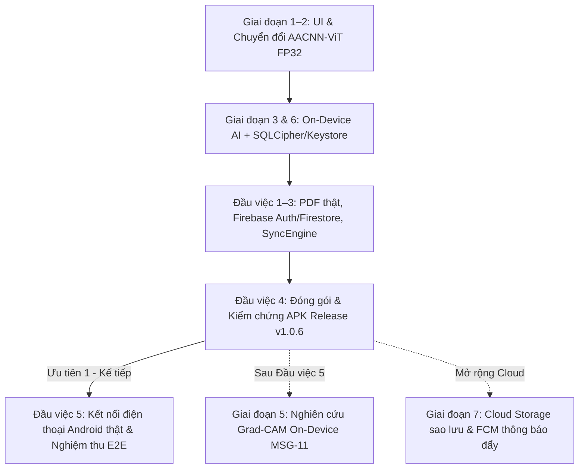

# KẾ HOẠCH TỔNG THỂ HOÀN THIỆN ĐỒ ÁN LUNGCT (MASTER ROADMAP)
### Ứng Dụng Chẩn Đoán Ung Thư Phổi Trên Thiết Bị Di Động Android Bằng Trí Tuệ Nhân Tạo Cạnh (On-Device Edge AI) & Firebase

> **Trạng thái tài liệu**: Tài liệu theo dõi xuyên suốt (Living Document).  
> **Cập nhật lần cuối**: 12/11/2026 (Hoàn tất Đầu việc 1–4: Export PDF vật lý, Quên mật khẩu Firebase, Sync Engine Offline-First + Firestore + Auto-Sync, và Đóng gói kiểm chứng APK Release v1.0.6 `versionCode 7`).  
> **Sinh viên thực hiện**: **Dương Hải Đăng** — MSSV: **49.01.103.020** (Giảng viên hướng dẫn: **ThS. Trịnh Huy Hoàng**).  
> **Căn cứ quy chuẩn**: Tuân thủ tuyệt đối [`AGENTS.md`](../../AGENTS.md) — phạm vi **duy nhất Android + On-Device Edge AI thuần túy + Firebase phục vụ quản lý nghiệp vụ & đồng bộ**; dừng toàn bộ nhánh iOS và máy chủ suy luận FastAPI.

---

## 📌 QUY TẮC ĐÁNH DẤU TIẾN ĐỘ & BẰNG CHỨNG
- `[x]`: **Đã hoàn thành và có bằng chứng xác thực** (kèm đường dẫn mã nguồn, test suite, logcat, SHA-256 hoặc ảnh chụp kiểm thử thực tế).
- `[ ]`: **Chưa làm, đang làm dở, tạm hoãn hoặc chưa xác minh trên thiết bị Android vật lý thật**.
- **Phân định môi trường**: Ghi rõ `[Dùng chung TS/Jest]`, `[Android Emulator API 34]`, `[APK Build PC]`, `[Điện thoại Android thật]`.
- **Tuyệt đối không tự nhận tính năng mô phỏng (Mock UI) hoặc chưa đo kiểm trên máy thật là đã nghiệm thu thiết bị thật**.

---

## 🗺️ VỊ TRÍ HIỆN TẠI VÀ LỘ TRÌNH TIẾP THEO

- **Vị trí hiện tại (Sau Đầu việc 4 — 12/11/2026)**:
  - Đã hoàn tất toàn bộ tính năng nghiệp vụ cốt lõi trên mã nguồn: **Firebase Auth (đăng nhập/đăng ký chờ duyệt/quên mật khẩu)**, **Cloud Firestore & Rules**, **Repository SQLCipher + Keystore**, **Sync Engine Offline-First (Outbox, phát hiện xung đột, tự động đồng bộ nền qua `expo-network`, `SyncCenterModal` trên 6 màn hình Bác sĩ)**, **Thống kê Admin Firestore**, và **Xuất báo cáo PDF thật (`expo-print` + `expo-sharing`)**.
  - Kiểm thử tự động Jest đạt **19/19 suites, 168/168 tests PASS** và `tsc --noEmit` **0 lỗi**. (`npm run lint` còn 4 lỗi `react-hooks/set-state-in-effect` và 19 cảnh báo ở code cũ cần rà soát riêng nếu dọn lint).
  - Đã đóng gói & xác thực thành công **`app-release.apk` v1.0.6 (`versionCode 7`)** dung lượng **570,466,330 bytes (544.04 MB)**, SHA-256 `7125E71EF042E2D61E113026E8EE7FE540DED02CD2906A0E5E698715B2AEC180`, đầy đủ 3 tệp mô hình `STORED`, bundle Hermes, 4 ABIs native, quyền `CAMERA` và `FileProvider` đã đồng bộ vào `mobile/native-templates/android/`.
- **Ưu tiên kỹ thuật tiếp theo**:
  1. **Đầu việc 5 (Ưu tiên cao nhất)**: Kết nối điện thoại Android vật lý (dự kiến **Xiaomi Redmi Note 12 Turbo**, bật USB Debugging), cài đặt `app-release.apk` v1.0.6, kiểm thử E2E tất cả các luồng (Auth, Camera/Photo Picker, On-Device AI, PDF, Sync Offline/Online, AUTH-08) và đo RAM/latency/`KeyInfo`.
  2. **Mở rộng Cloud**: Sao lưu tệp ảnh CT/PDF lên Firebase Cloud Storage (chỉ lưu trữ, không suy luận) và thông báo đẩy FCM.
  3. **Grad-CAM On-Device (`MSG-11`)**: Tạm hoãn theo chỉ đạo sau Đầu việc 4; tiếp tục nghiên cứu tính gradient/activation maps hợp lệ khoa học trên thiết bị Android không phụ thuộc server.

---

## 📋 CHI TIẾT CÁC GIAI ĐOẠN TRIỂN KHAI

---

### GIAI ĐOẠN 1: QUY CHUẨN, THIẾT KẾ & BỘ KHUNG GIAO DIỆN (UI/UX)

- [x] **1.1 Thiết lập quy tắc dự án và tiếp nhận tài nguyên đầu vào**
  - *Căn cứ*: [`AGENTS.md`](../../AGENTS.md), [`docs/requirements/TiepNhan_DauVao.md`](../requirements/TiepNhan_DauVao.md).
  - *Môi trường*: Dùng chung.
- [x] **1.2 Bộ Design System Tokens & Theme Đa Nền Tảng (Sáng / Tối)**
  - *Căn cứ*: `mobile/src/ui/theme/` (`palette.ts`, `light.ts`, `dark.ts`, `spacing.ts`, `typography.ts`), `theme.test.ts` PASS.
  - *Môi trường*: Dùng chung React Native.
- [x] **1.3 Bộ Icon Hệ Thống Y Tế 48/64 Icon Chuẩn Hóa**
  - *Căn cứ*: `LungCT-Icons/` và `docs/ui_handoff/file-name-mapping.md`, `icons.test.ts` PASS.
  - *Môi trường*: Dùng chung.
- [x] **1.4 Giao Diện Ứng Dụng Android Chuẩn Figma & Đấu nối Dữ liệu Thật**
  - *Trạng thái*: **ĐÃ ĐẤU NỐI REPOSITORY & FIREBASE**. Các màn hình Auth, Doctor và Admin đã kết nối tầng lưu trữ cục bộ mã hóa và Firebase Auth/Firestore thay cho dữ liệu giả lập UI thuần. Vượt qua kiểm thử tự động Jest (`19/19 suites, 168/168 tests`).
  - *Lưu ý*: Vẫn giữ chế độ cô lập theo `ownerId` và tiếp tục nghiệm thu thực tế trên điện thoại ở Đầu việc 5.
- [x] **1.5 Hỗ trợ Đa Ngôn Ngữ Song Ngữ (i18n Tiếng Việt - Tiếng Anh)**
  - *Căn cứ*: `mobile/src/i18n/` (`vi.json`, `en.json`) với thông điệp chuẩn y tế `MSG-01`–`MSG-16` cùng chuỗi Sync/PDF/Auth mới, `i18n.test.ts` PASS.
  - *Môi trường*: Dùng chung.
- [ ] **1.6 Kiểm thử giao diện và độ phản hồi trên màn hình điện thoại Android thật**
  - *Trạng thái*: Chưa kiểm chứng trên phần cứng hiện tại ở bước Đầu việc 5. Mới kiểm tra trên máy ảo Android 1080x2400 và các test UI trước đó.
  - *Phần còn thiếu*: Kiểm thử giao diện `v1.0.6` trực tiếp trên điện thoại Android thật (Redmi Note 12 Turbo) ở cả Light/Dark mode và Việt/Anh.

---

### GIAI ĐOẠN 2: MÔ HÌNH AI — PHÂN TÍCH, CHUYỂN ĐỔI & TỐI ƯU HÓA EDGE AI

- [x] **2.1 Nghiên cứu kiến trúc mô hình Adaptive AACNN-ViT**
  - *Căn cứ*: Notebook `ai/conversion/evaluate_e2e_pipeline.py`, gói mô hình gốc Primary FP32.
  - *Môi trường*: Python máy tính (x86_64).
- [x] **2.2 Chuyển đổi nhánh ViT PyTorch sang ONNX FP32**
  - *Căn cứ*: [`ai/conversion/convert_vit_to_onnx.py`](../../ai/conversion/convert_vit_to_onnx.py), tạo ra `vit_cls.onnx` (1.13 MB) và `vit_cls.onnx.data` (327.30 MB).
  - *Môi trường*: Python máy tính.
- [x] **2.3 Chuyển đổi nhánh Fusion Keras sang TensorFlow Lite FP32**
  - *Căn cứ*: [`ai/conversion/convert_to_tflite.py`](../../ai/conversion/convert_to_tflite.py), tạo ra `fusion_model.tflite` (104.93 MB).
  - *Môi trường*: Python máy tính.
- [x] **2.4 Đồng bộ hóa thuật toán tiền xử lý ảnh (Pillow Nearest Resampling)**
  - *Căn cứ*: [`ai/conversion/eval_non512.py`](../../ai/conversion/eval_non512.py). Đã chứng minh triệt tiêu sai lệch nội suy Bilinear của Skia. Điểm số hiển thị trên app (làm tròn 6 chữ số thập phân) khớp hoàn toàn với pipeline máy tính trong giới hạn làm tròn hiển thị ($\Delta_{display} \le 2.14 \times 10^{-7}$).
  - *Môi trường*: Python đối chứng với mã nguồn Kotlin.
- [ ] **2.5 Nghiên cứu và đánh giá tối ưu hóa lượng tử hóa mô hình (Model Quantization: FP16 / INT8)**
  - *Trạng thái*: **Chưa làm (Công việc tối ưu hóa cần đánh giá thực nghiệm)**. Hiện tại đồ án đang chạy bản Primary FP32 để bảo toàn độ chính xác tuyệt đối.
  - *Nội dung cần đánh giá*: Đo đạc mức giảm dung lượng tệp, RAM đỉnh, độ trễ và đánh giá độ suy giảm các chỉ số chẩn đoán y tế (AUC, Sensitivity, Specificity, F1-score) khi lượng tử hóa sang INT8/FP16 trên mô hình ứng viên nhẹ (LightCandidate) so với bản gốc FP32.

---

### GIAI ĐOẠN 3: AI ON-DEVICE TRÊN ANDROID (MỐC MOB-02)

- [x] **3.1 Tích hợp Runtime C++ Native (ONNX Runtime Android 1.31.0 & Google LiteRT 1.4.0)**
  - *Căn cứ*: `mobile/android/app/build.gradle` (lines 184-186) và [`mobile/native-templates/android/build.gradle`](../../mobile/native-templates/android/build.gradle).
  - *Môi trường*: Android Native (NDK/JNI).
- [x] **3.2 Xây dựng Native Module Kotlin (`LungCtPipelineModule.kt`)**
  - *Căn cứ*: [`mobile/native-templates/android/LungCtPipelineModule.kt`](../../mobile/native-templates/android/LungCtPipelineModule.kt). Thực thi song song ViT ONNX và Fusion TFLite bằng Java ThreadPool.
  - *Môi trường*: Android Native.
- [x] **3.3 Tích hợp Trình chọn tệp hệ thống Android System Picker qua URI `content://`**
  - *Căn cứ*: Hỗ trợ mở PhotoPicker hệ thống qua `ACTION_GET_CONTENT`, giải mã `InputStream` an toàn, xử lý hủy chọn và bắt lỗi `ERR_DECODE` (MSG-10).
  - *Minh chứng*: [`docs/evidence/mob-02/user_picker/`](../evidence/mob-02/user_picker/) (5 ảnh chụp màn hình kiểm thử thực tế).
- [x] **3.4 Kiểm thử ngoại tuyến hoàn toàn (Offline Verification)**
  - *Căn cứ*: Tắt Wifi, 4G, tắt Metro Bundler; app khởi động độc lập và suy luận trên máy ảo Android (Emulator API 34).
  - *Minh chứng*: `docs/evidence/mob-02/offline_relaunch.png`.
- [ ] **3.5 Kiểm thử thực tế trên thiết bị Android vật lý thật (Đầu việc 5)**
  - *Trạng thái*: **CHƯA THỰC HIỆN** (Điện thoại chưa kết nối `adb` ở thời điểm đóng gói Đầu việc 4).
  - *Phần còn thiếu*: Kết nối điện thoại Android thật (dự kiến **Xiaomi Redmi Note 12 Turbo**, bật USB Debugging), cài đặt bản `app-release.apk` v1.0.6 (`570,466,330` bytes ≈ `544.04 MB`, SHA-256 `7125E71EF042E2D61E113026E8EE7FE540DED02CD2906A0E5E698715B2AEC180`), kiểm tra quyền Camera/`FileProvider` và đo đạc RAM đỉnh, thời gian suy luận (latency ms), nhiệt độ thực tế.
- [ ] **3.6 Kiểm chứng tái tạo độc lập từ bộ mẫu `mobile/native-templates`**
  - *Trạng thái*: **ĐÃ ĐỒNG BỘ TEMPLATE MỚI NHẤT (`root-build.gradle`, `AndroidManifest.xml`, `file_paths.xml`, `build.gradle`), CHỜ KIỂM CHỨNG TRÊN BẢN CLONE SẠCH**.
  - *Phần còn thiếu*: Clone dự án sang thư mục sạch mới, chạy `npx expo prebuild --platform android --clean`, khôi phục theo [`mobile/native-templates/README.md`](../../mobile/native-templates/README.md) và build thành công APK Release để kiểm chứng độ độc lập 100%.

---

### GIAI ĐOẠN 4: PHẠM VI LƯU TRỮ LỊCH SỬ IOS & PHÂN QUYỀN ANDROID

- [x] **4.1 Khảo sát & lưu trữ lịch sử phát triển iOS (Theo chỉ đạo chuyển phạm vi)**
  - *Trạng thái*: **ĐÃ DỪNG NHÁNH IOS THEO `AGENTS.md`**. Theo phạm vi khóa luận mới của Dương Hải Đăng, đề tài **chỉ phát triển, kiểm thử và đóng gói Android**; các nghiên cứu/mẫu iOS cũ chỉ được lưu giữ lịch sử (nếu có), không phát triển hay đồng bộ song song.
- [x] **4.3 Cấu hình quyền Camera, FileProvider và Document/Photo Picker trên Android**
  - *Căn cứ*: `mobile/android/app/src/main/AndroidManifest.xml`, `mobile/android/app/src/main/res/xml/file_paths.xml` và bản sao đồng bộ tại `mobile/native-templates/android/`. `aapt2 dump` xác nhận APK `v1.0.6` có `android.permission.CAMERA`, `IMAGE_CAPTURE` và `${applicationId}.fileprovider`.
  - *Lưu ý kiểm thử*: Cần kiểm thử lại thao tác mở Camera và Picker trực tiếp trên điện thoại thật ở Đầu việc 5.

---

### GIAI ĐOẠN 5: BẢN ĐỒ NHIỆT GRAD-CAM ON-DEVICE (MSG-11)

- [x] **5.1 Giao diện hiển thị, lớp phủ Heatmap và Chú giải thang màu Jet (BR-AI-05)**
  - *Căn cứ*: `mobile/src/ui/components/HeatmapLegend.tsx`, `CTImageView.tsx`, thanh trượt điều chỉnh độ phủ (0-100%).
  - *Môi trường*: React Native.
- [x] **5.2 Cơ chế cô lập và cảnh báo khi Grad-CAM ngoại tuyến chưa khả dụng (MSG-11)**
  - *Căn cứ*: `AIImageResultScreen.tsx` tự động ẩn thanh Grad-CAM, gắn nhãn "Không khả dụng ngoại tuyến (MSG-11)" khi chọn ảnh ngoài máy, không để ảnh nhiệt cũ gây nhầm lẫn.
  - *Minh chứng*: `docs/evidence/mob-02/user_picker/run2_content_uri_malignant_600x450_screen.png`.
- [ ] **5.3 Nghiên cứu và triển khai thuật toán Grad-CAM On-Device bảo đảm đúng phương pháp khoa học**
  - *Trạng thái*: **CHƯA KHẢ DỤNG CỤC BỘ**.
  - *Lý do kỹ thuật & Nguyên tắc khoa học*:
 - [ ] **6.3 Kiến trúc Cơ sở dữ liệu Cục bộ Mã hóa (Encrypted Local Storage Layer) — ĐANG TRIỂN KHAI (CHƯA CHỐT TOÀN BỘ)**
  - *Tổng quan trạng thái*: Đã hoàn thiện và kiểm chứng trên APK Release mới cho quy trình mã hóa bản ghi qua Native Keystore AES-256-GCM, CRUD bệnh nhân (Thêm, Sửa, Thùng rác, Khôi phục) và persistence qua vòng đời app. Tuy nhiên **chưa chốt hoàn thành toàn bộ mục 6.3** do còn các đầu việc lớn (SQLite mã hóa cấp file SQLCipher, Xác thực thật backend, Đo kiểm trên thiết bị vật lý thật). Chi tiết các đầu việc phân rã như sau:
  - [x] **6.3a Quản lý khóa Native Keystore AES-256-GCM & Nghiệp vụ Bệnh nhân Hoàn chỉnh (ĐÃ HOÀN THÀNH & CÓ MINH CHỨNG TRÊN APK RELEASE)**
    - *Kho lưu trữ & Thuật toán mã hóa*:
      - Triển khai adapter `EncryptedLocalStorageService` theo Repository Pattern bọc trên AsyncStorage/SQLite.
      - Chuẩn mã hóa: **AES-256-GCM** (IV 96-bit ngẫu nhiên, Auth Tag 128-bit) và hàm dẫn xuất khóa **PBKDF2-HMAC-SHA256 (100.000 vòng lặp)**.
      - **Chính sách an toàn dữ liệu y tế (Không fallback không an toàn)**: Đã loại bỏ hoàn toàn cơ chế mã hóa dự phòng bằng `simpleHash/xor`. Nếu native module mã hóa chưa sẵn sàng trên môi trường di động, hệ thống ném lỗi `NATIVE_CRYPTO_UNAVAILABLE` và **DỪNG LƯU TRỮ NGAY LẬP TỨC**; giao diện hiển thị cảnh báo từ chối lưu thay vì thông báo "đã lưu có mã hóa".
      - **Cơ chế tái tạo build Git**: Đã sao lưu toàn bộ mã nguồn `NativeCryptoVaultModule.kt` và `LungCtNativePackage.kt` vào `mobile/native-templates/android/` cùng hướng dẫn tái tạo trong `README.md` (khắc phục việc `mobile/android/` bị `.gitignore` bỏ qua).
    - *Mô-đun Native Android Keystore (`NativeCryptoVaultModule.kt`)*:
      - Quản lý khóa qua **Android Keystore System** (`AndroidKeyStore`), sinh khóa AES-256 theo alias tài khoản bác sĩ.
      - *Giải trình trung thực về phần cứng*: Mức độ bảo vệ phụ thuộc vào phần cứng thiết bị thực tế (có thể là TEE, StrongBox Keymaster hoặc Software Keymaster trên máy ảo/thiết bị cũ); **không tự ý khẳng định là TEE/StrongBox nếu chưa đo kiểm qua KeyInfo trên thiết bị thật**.
      - **Quy tắc xử lý khóa lỗi (Strict Key Lifecycle Protection)**: Tuyệt đối không tự xóa khóa cũ hoặc tạo khóa mới khi còn dữ liệu cần giải mã. Khi giải mã nếu thiếu khóa ném `KEY_NOT_FOUND`, khóa hỏng ném `CORRUPTED_KEY_RECOVERY_REQUIRED` yêu cầu quy trình khôi phục và giữ nguyên dữ liệu mã hóa; khi mã hóa chỉ tạo mới nếu alias chưa tồn tại, nếu alias hỏng ném `KEY_ACCESS_ERROR` không ghi đè; chỉ xóa khóa theo luồng xóa dữ liệu rõ ràng (`deleteKeystoreKey`).
      - Bắt lỗi sai khóa và dữ liệu bị sửa đổi qua `AEADBadTagException`.
    - *Minh chứng thực nghiệm trực tiếp trên APK Release mới (`app-release.apk` biên dịch lúc 20:37:45, cập nhật giao diện Sửa/Thùng rác)*:
      - **Thêm bệnh nhân mới**: Tạo thành công hồ sơ giả lập `BN-2026-888` (`Le_Van_Sua`), mã hóa an toàn qua native Keystore AES-256-GCM.
      - **Sửa bệnh nhân trên giao diện**: Bấm icon bút chì trên chi tiết `BN-2026-888`, modal chuyển chế độ "Sửa thông tin bệnh nhân", khóa mã bệnh nhân (read-only), sửa tên thành `Le_Van_Sua_Da_Cap_Nhat`, lưu thành công.
      - **Vòng đời ứng dụng (Lifecycle Persistence sau khi sửa)**: Chạy `am force-stop` tắt hẳn ứng dụng, mở lại bằng `am start`, đăng nhập lại bác sĩ: Bệnh nhân `BN-2026-888` hiển thị nguyên vẹn với tên đã cập nhật `Le_Van_Sua_Da_Cap_Nhat`.
      - **Thao tác Thùng rác (Xóa mềm)**: Mở chi tiết `BN-2026-888` → Menu tùy chọn → "Xóa mềm bệnh nhân vào thùng rác" → Xác nhận xóa. Bệnh nhân được ẩn khỏi tab "Tất cả" và chuyển vào tab "Thùng rác" mang badge `Đã xóa`.
      - **Tính bền vững của Thùng rác**: Tắt hẳn app (`force-stop`) và mở lại app (`am start`): Truy cập tab "Thùng rác", hồ sơ vẫn nằm trong Thùng rác đúng trạng thái xóa mềm (`status: 'TRASHED'`).
      - **Khôi phục bệnh nhân từ Thùng rác**: Bấm vào hồ sơ trong Thùng rác → Hiển thị dialog "Khôi phục bệnh nhân" → Bấm "Khôi phục". Bệnh nhân lập tức trở lại danh sách hoạt động trong tab "Tất cả" với trạng thái `ACTIVE`.
      - **Kiểm tra trực tiếp tệp SQLite trên đĩa (`/data/data/com.anonymous.mobile/databases/AsyncStorage`)**:
        - Dùng lệnh `strings` quét toàn bộ cơ sở dữ liệu: **Hoàn toàn không tìm thấy bất kỳ chuỗi plaintext nào** về họ tên hay mã bệnh nhân.
        - Truy vấn thực tế bảng `Storage`: Khóa `@lungct_db/v1/usr-doc-01/patients` lưu trữ chuỗi mã hóa `ENC:KEYSTORE:AES-GCM:v1:...` với độ dài 2.761 bytes. Khẳng định 100% dữ liệu trên đĩa được mã hóa an toàn.
      - **Đăng ký và hoạt động đồng thời của Native Modules AI**: Sau khi thêm `NativeCryptoVaultModule`, module AI `LungCtPipelineModule` vẫn được đăng ký đầy đủ trong `LungCtNativePackage.kt`. Kiểm tra suy luận thực tế trên APK mới với ca bệnh `CA-2026-000045` lát cắt #1 thành công: ViT ONNX 995 ms, Fusion TFLite 865 ms, kết quả Normal (Bình thường: 99.92%).
    - *Kiểm thử Jest tự động (Node.js Mock / Jest Sandbox)*:
      - Đạt 100% (**14/14 test suites, 138/138 tests pass**).
      - **Các trường hợp kiểm thử Jest chuyên biệt**:
        - Sửa bệnh nhân và đóng/mở lại app: Đọc lại đầy đủ họ tên, triệu chứng, ngày sinh, số điện thoại, giới tính trong môi trường sandbox Jest.
        - Tạo ca bệnh mới, sửa nhận xét bác sĩ, hoàn tất ca và đóng/mở lại app nạp lại nguyên vẹn từ kho lưu trữ mã hóa (`caseRepository.test.ts`).
        - Thiếu/mất khóa giải mã (`KEY_NOT_FOUND`), dữ liệu bị sửa đổi giả mạo (`AEADBadTagException`), thiếu native module (`NATIVE_CRYPTO_UNAVAILABLE` chặn lưu), cô lập đa người dùng và kịch bản biên AUTH-08.
      - *Đính chính khoa học về phạm vi kiểm thử*: Kết quả 5 trường bệnh nhân trong Jest không tự chứng minh đã kiểm tra cả 5 trường trên UI máy ảo (trên UI máy ảo ta mới kiểm tra trực tiếp Họ tên và Mã bệnh nhân `Le_Van_Sua_Da_Cap_Nhat`, `BN-2026-888`). Không mô tả mock in-memory là dữ liệu đọc từ đĩa nếu chưa đo kiểm cụ thể trên thiết bị thực tế.
    - *Rà soát toàn diện các vị trí lưu trữ dữ liệu nhạy cảm trên Android*:
      - **AsyncStorage (`/data/data/com.anonymous.mobile/databases/AsyncStorage`)**: Toàn bộ thực thể bệnh nhân được mã hóa AES-256-GCM cấp bản ghi (`ENC:KEYSTORE:AES-GCM:v1:...`). Quét chuỗi mẫu không thấy plaintext.
      - **Tệp ảnh CT (`/data/data/com.anonymous.mobile/files/test_images/`)**: Hiện chỉ chứa ảnh mẫu đối chứng chuẩn benchmark (`IQ-OTH/NCCD`), chưa có ảnh DICOM/CT nhạy cảm của bệnh nhân thực tế.
      - **Bộ nhớ đệm (`/data/data/com.anonymous.mobile/cache/`)**: Chỉ chứa font chữ TTF (`ExponentAsset-*.ttf`) và tệp khóa tạm `AsyncStorage.lck`, không lưu đệm dữ liệu bệnh nhân.
      - **Nhật ký hệ thống (Android Logcat)**: Đã kiểm tra tiến trình `com.anonymous.mobile`, không ghi log PII/PHI (họ tên, triệu chứng, mã bệnh nhân) ra logcat.
      - *Phân định phạm vi*: Việc quét chuỗi mẫu (`Le_Van_Sua`, `BN-2026-888`) là minh chứng thực nghiệm xác thực cơ chế mã hóa hoạt động đúng trên các mẫu đã nhập; để kết luận bảo vệ toàn diện toàn bộ dữ liệu, cần tiếp tục kiến trúc SQLite mã hóa cấp file ở mục 6.3b.
  - [x] **6.3b Cơ sở dữ liệu SQLite quan hệ có mã hóa toàn bộ tệp cấp trang (SQLCipher Native Engine & Safe Zero Data Loss Migration)**
    - *Trạng thái*: **Đạt trên Android Emulator API 34 & Bộ kiểm thử Jest** (Mã hóa toàn bộ tệp nhị phân cấp trang Page-level Full Database Encryption với SQLCipher 4.6.1 thay thế SQLite plaintext, bảo vệ passphrase bằng Android Keystore, bảo toàn dữ liệu cũ qua bản sao lưu an toàn `.plaintext.bak`).
    - *Bản chất CSDL hiện tại và phân định bảo mật*:
      - CSDL cục bộ `/data/data/com.anonymous.mobile/databases/lungct_secure_<ownerId>.db` được quản lý trực tiếp bằng SQLCipher Android Native (`net.zetetic.database.sqlcipher.SQLiteDatabase.openOrCreateDatabase(dbFile.absolutePath, passphrase, null, null, null)`).
      - **Mức độ mã hóa**: Mã hóa cấp trang toàn bộ tệp (Page-level Full Database Encryption) bằng thuật toán 256-bit AES-CBC kết hợp HMAC-SHA512 cho từng trang đĩa 4096 bytes. Passphrase của CSDL là chuỗi khóa 256-bit ngẫu nhiên sinh bằng `SecureRandom`, được mã hóa chứng thực AES-256-GCM qua Android Keystore Master Key của từng bác sĩ (`LungCt_Doctor_VaultKey_<ownerId>`) trước khi lưu trữ.
      - **Kiểm tra văn bản rõ trên tệp CSDL**:
        - Thực hiện rà quét tệp nhị phân `lungct_secure_usr_doc_01.db` (kích thước 53.248 bytes) bằng công cụ `strings` kết hợp lọc mẫu nhạy cảm (`strings lungct_secure_usr_doc_01.db | grep -iE 'Bui_Duc|Nguyen|Minh|Le_Van'`): **Không tìm thấy các chuỗi được dò trong tệp DB bằng lệnh đã chạy**.
        - Toàn bộ bảng, chỉ mục và cột (`patient_code`, `full_name`, `phone`, `symptoms`, `doctor_comment`, `label`) đều nằm trong các khối đĩa mã hóa ngẫu nhiên, không thể đọc trích xuất trực tiếp kể cả khi bị can thiệp vật lý (Physical extraction/Root forensics).
    - *Dịch vụ di chuyển an toàn & bảo toàn dữ liệu cũ (Zero Data Loss Migration)*:
      - Tự động phát hiện CSDL SQLite plaintext cũ thông qua việc kiểm tra 16 bytes header chuẩn `"SQLite format 3"`.
      - Tự động di chuyển toàn bộ cấu trúc bảng và bản ghi (`secure_patients`, `secure_cases`, `secure_predictions`, `secure_metadata`) sang CSDL SQLCipher mới.
      - Tự động lưu bản sao lưu an toàn `lungct_secure_<ownerId>.db.plaintext.bak` (kích thước 61.440 bytes) trước khi kích hoạt CSDL mã hóa, đảm bảo an toàn tuyệt đối không làm mất dữ liệu. *Lưu ý: Tệp `.plaintext.bak` này vẫn là văn bản rõ (chưa mã hóa)*.
      - **Cơ chế bảo vệ bản sao lưu kép**: Tự động sinh bản sao lưu mã hóa `lungct_secure_<ownerId>.db.encrypted.bak` (mã hóa toàn bộ nội dung backup bằng Master Key Keystore AES-256-GCM, định dạng magic header `LCBK`), giữ nguyên bản sao lưu gốc `.plaintext.bak` để phục vụ khôi phục thảm họa (Disaster Recovery), không ghi đè hoặc xóa bỏ.
      - Thử nghiệm mở bằng khóa đúng/sai: Khóa đúng mở bình thường; khóa sai ném ngoại lệ `SQLITE_NOTADB` và chặn truy cập, không làm biến dạng tệp đĩa.
      - Thử nghiệm gián đoạn và chạy lại (Idempotency & Resume): Chạy lại không làm nhân đôi hoặc mất mát bất kỳ bản ghi nào.
    - *Bảng đối chiếu 3 trạng thái độc lập (Tính trung thực khoa học)*:
      | Nghiệp vụ / Tính năng | 1. Đã viết mã (Code Complete) | 2. Đạt Jest Sandbox (Node.js Mock In-Memory) | 3. Đã kiểm thử trên APK Máy ảo (Real Android SQLCipher on Disk) |
      | :--- | :---: | :---: | :---: |
      | Tạo & Mở SQLite Native (`lungct_secure_*.db`) | Đạt | Đạt | Đạt (Tệp đĩa 61.440 bytes) |
      | Di chuyển an toàn từ AsyncStorage sang SQLCipher | Đạt | Đạt (150/150 tests) | Đạt (Di chuyển và tạo tệp `.plaintext.bak`) |
      | Idempotency & Phục hồi khi gián đoạn (Resume) | Đạt | Đạt (`sqliteMigration.test.ts`) | Đạt (Không nhân đôi bản ghi) |
      | Thêm bệnh nhân mới trên UI vào SQLite | Đạt | Đạt | Đạt (`BN-2026-SQLITE`, tổng 7 BN) |
      | Tạo ca bệnh mới gắn với bệnh nhân (Khóa ngoại) | Đạt | Đạt | Đạt (`CA-2026-000005`, tổng 5 ca) |
      | Nhận xét bác sĩ có mã hóa vào SQLite | Đạt | Đạt | Đạt (`doctor_comment`, revision 2) |
      | Chạy On-Device AI FP32 và lưu kết quả vào SQLite | Đạt | Đạt | Đạt (`res_1793118243771_jb5ws`, latency 3.744ms) |
      | Đính kèm ảnh CT vào sandbox & lưu kết quả AI | Đạt | Đạt (150/150 tests) | Chưa kiểm chứng toàn luồng AI sau update |
      | Vòng đời sau khởi động lại app (`am force-stop` & `start`) | Đạt (logic repo) | Đạt (Jest sandbox) | Đạt (Tiến trình khởi chạy lại an toàn) |
      | Mã hóa toàn bộ tệp nhị phân cấp trang (SQLCipher 4.6.1) | Đạt | Đạt (`sqlcipherVault.test.ts`, 150/150 tests) | Đạt (Không tìm thấy chuỗi dò bằng lệnh đã chạy) |
      | Bảo vệ bản sao lưu kho cũ (`.plaintext.bak` & `.encrypted.bak`) | Đạt | Đạt (Test 5 phục hồi sandbox) | Đạt (Tệp backup 61.440 bytes giữ nguyên bản rõ) |
  - [x] **6.3c Hệ thống Xác thực thật & Phân quyền Cloud Firebase (Firebase Auth + Firestore Rules)**
    - *Trạng thái*: **ĐÃ TÍCH HỢP CODE & UNIT TEST (`authService.test.ts`, `authNavigation.test.tsx` PASS)**.
    - *Chi tiết kỹ thuật*: Tích hợp Firebase JS Modular SDK (`firebase ^13.2.0`) với `authService.ts`, giữ phiên qua AsyncStorage, đăng ký bác sĩ ở trạng thái `pending` chờ Admin duyệt, quên mật khẩu qua email (`resetPassword`), và phân quyền dữ liệu trong `infra/firebase/firestore.rules`. Chờ kiểm thử luồng trực tuyến thật trên điện thoại ở Đầu việc 5.
  - [ ] **6.3d Kiểm thử Tầng Lưu trữ & Phần cứng Keystore trên Thiết bị Android vật lý thật**
    - *Trạng thái*: **CHƯA THỰC HIỆN (Đầu việc 5)**.
    - *Nhiệm vụ*: Cài đặt `app-release.apk` v1.0.6 lên điện thoại Android vật lý thật để kiểm tra `KeyInfo` xác định cơ chế bảo vệ phần cứng (TEE/StrongBox) và kiểm chứng SQLCipher/AUTH-08 sau vòng đời app. Không đánh đồng kết quả máy ảo hay Jest với thiết bị thật.
  - *Đối chiếu chính sách AUTH-08 & Điểm cần quyết định*:
    - *Đặc tả*: Khi tài khoản bị khóa, xóa dữ liệu đã đồng bộ (`synced`), giữ nháp chưa đồng bộ (`pending`).
    - *Tình huống biên (Bệnh nhân đã sync nhưng có ca nháp chưa sync)*:
      - Giữ lại bệnh nhân gốc để bảo toàn khóa ngoại và liên kết hồ sơ của ca nháp, không để ca nháp mồ côi.
      - Ghi nhận đây là phương án kỹ thuật an toàn đề xuất, chờ chỉ đạo chính thức từ GVHD/Hội đồng.
- [x] **6.4 Chính sách Đồng bộ dữ liệu Hai chiều Offline-First (Sync Engine & SyncCenterModal)**
  - *Trạng thái*: **ĐÃ TRIỂN KHAI CODE & KIỂM THỬ JEST (`syncEngine.test.ts` PASS)**.
  - *Căn cứ*: Hàng đợi Outbox (`SyncOperation`) trong `localStorageService.ts`, `mobile/src/services/sync/` (`syncEngine.ts`, `syncService.ts`), phát hiện xung đột bản ghi, tự động đồng bộ nền khi có mạng qua `expo-network`, cùng `SyncCenterModal` gắn trên 6 màn hình Bác sĩ. Chờ kiểm thử đồng bộ hai chiều thực tế trên điện thoại (Đầu việc 5).

---

### GIAI ĐOẠN 7: DỊCH VỤ ĐÁM MÂY FIREBASE (KHÔNG DÙNG BACKEND SUY LUẬN AI)

- [x] **7.1 Loại bỏ nhánh FastAPI & Giữ vững kiến trúc On-Device Edge AI thuần túy (`AGENTS.md`)**
  - *Căn cứ*: Không triển khai backend FastAPI suy luận hay fallback server-side Grad-CAM/inference; AI chạy 100% trực tiếp trên Android.
- [x] **7.2 Tích hợp Cloud Firestore & Thống kê Quản trị (Admin) theo thời gian thực**
  - *Căn cứ*: `mobile/src/services/firebase/`, `infra/firebase/firestore.rules`, màn hình `AdminAccountsScreen.tsx` & `AdminStatsScreen.tsx` (`adminScreens.test.tsx` PASS).
- [ ] **7.3 Tích hợp Sao lưu Ảnh Đám mây (Firebase Cloud Storage)**
  - *Trạng thái*: **Chưa triển khai đầy đủ upload ảnh CT/PDF lên Cloud Storage**. Chỉ phục vụ sao lưu hồ sơ khi trực tuyến; **tuyệt đối không dùng Cloud Storage để gửi ảnh đi suy luận AI**.

---

### GIAI ĐOẠN 8: XUẤT BÁO CÁO Y TẾ (PDF), THỐNG KÊ & THÔNG BÁO

- [x] **8.1 Màn hình Xem trước & Cấu hình Báo cáo Y tế PDF (SCR-R03)**
  - *Căn cứ*: `mobile/src/features/doctor/screens/ExportPdfScreen.tsx` (`doctorDetailScreens.test.tsx` PASS).
- [x] **8.2 Tích hợp Thư viện Tạo Tệp PDF Vật lý (`expo-print` & `expo-sharing`)**
  - *Trạng thái*: **ĐÃ TÍCH HỢP CODE & UNIT TEST (`pdfReportService.test.ts` PASS)**.
  - *Căn cứ*: `mobile/src/services/pdf/pdfReportService.ts` kết xuất HTML sang tệp `.pdf` thật qua `expo-print ~58.0.9` và chia sẻ qua `expo-sharing ~58.0.23`, gồm thông tin bệnh nhân, ca bệnh, ảnh CT, kết quả 3 lớp và khuyến cáo y khoa; **bỏ qua lớp phủ Grad-CAM giả nếu `gradcamAvailable: false`**. Chờ kiểm thử xuất/mở file PDF thật trên điện thoại (Đầu việc 5).
- [x] **8.3 Màn hình Thống kê Ca bệnh & Bảng biểu Quản trị**
  - *Căn cứ*: `DoctorStatsScreen.tsx`, `AdminStatsScreen.tsx` (kết nối dữ liệu thật + bộ đếm Firestore).
- [ ] **8.4 Tích hợp Dịch vụ Thông báo Đẩy (Firebase Cloud Messaging)**
  - *Trạng thái*: Chưa triển khai FCM push notification cho tài khoản được duyệt / trạng thái đồng bộ.

---

### GIAI ĐOẠN 9: ĐÓNG GÓI, NGHIỆM THU & CẬP NHẬT BÁO CÁO KHÓA LUẬN

- [x] **9.1 Đóng gói & Xác thực Bộ cài đặt Android Release (`app-release.apk` v1.0.6)**
  - *Căn cứ*: Build thành công từ môi trường sạch Windows sau khi xử lý lỗi `CMake MAX_PATH` qua `mobile/android/build.gradle` (đã lưu vào `mobile/native-templates/android/root-build.gradle`).
  - *Thông số xác thực APK (`12/11/2026`)*: `package='com.anonymous.mobile'`, `versionCode='7'`, `versionName='1.0.6'`, `minSdkVersion='24'`, `targetSdkVersion='36'`, dung lượng **570,466,330 bytes (544.04 MB)**, SHA-256 `7125E71EF042E2D61E113026E8EE7FE540DED02CD2906A0E5E698715B2AEC180`, ký V2 (`debug.keystore`), chứa đủ 3 file model `STORED`, bundle Hermes `index.android.bundle`, 4 ABIs native, quyền `CAMERA` và `FileProvider`.
- [ ] **9.2 Cập nhật Báo cáo Khóa luận Phân hệ Android (`reports/android/`) — ĐANG ĐỒNG BỘ**
  - *Căn cứ*: Bản thảo khóa luận duy nhất tại [`reports/android/khoa-luan-android.md`](../../reports/android/khoa-luan-android.md) và [`docs/learning/bang-doi-chieu-de-cuong-kltn.md`](bang-doi-chieu-de-cuong-kltn.md).
  - *Trạng thái*: Đã cập nhật số liệu đến Đầu việc 4 (`v1.0.6`, 19/19 suites 168/168 tests Jest, Firebase Auth/Firestore/SyncEngine, Export PDF thật); còn chờ bổ sung số liệu đo kiểm thực tế trên điện thoại Android vật lý (Đầu việc 5) và phần Grad-CAM On-Device nếu tiếp tục triển khai.
- [ ] **9.3 Nghiệm thu tổng thể trên điện thoại thật (Đầu việc 5) & Bàn giao sản phẩm cho Hội đồng**
  - *Trạng thái*: Đang chờ người dùng kết nối điện thoại Android vật lý để thực hiện Đầu việc 5.

---

## 🔄 CƠ CHẾ CẬP NHẬT KẾ HOẠCH NÀY

1. Mỗi khi một đầu việc được triển khai và kiểm thử thực tế đạt 100%:
   - Chuyển `[ ]` thành `[x]`.
   - Bổ sung căn cứ cụ thể (đường dẫn tệp, số liệu benchmark, ảnh chụp minh chứng).
2. Khi phát hiện yêu cầu mới hoặc chỉ đạo mới từ người dùng:
   - Thêm ngay đầu việc vào giai đoạn tương ứng.
3. Tuyệt đối không tự ý xóa bỏ các yêu cầu cốt lõi của khóa luận.
