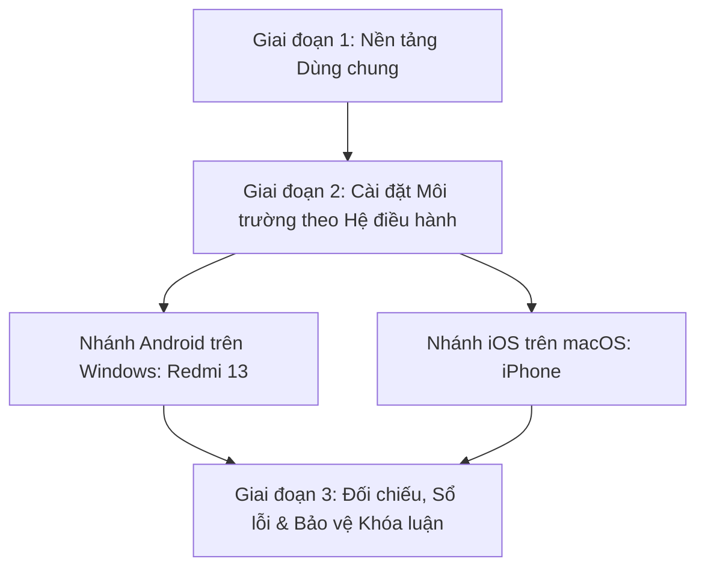

# BỘ GIÁO TRÌNH TỰ CODE LẠI LUNGCT TỪ ĐẦU CHO ANDROID VÀ IOS
### Hướng dẫn xây dựng ứng dụng di động hỗ trợ chẩn đoán ung thư phổi bằng Edge AI từ thư mục trống

> **Phiên bản tài liệu**: 1.0.0 (Biên soạn cho Khóa luận tốt nghiệp 2026 – 2027)  
> **Người thực hiện**:
> - **Phân hệ Android**: Dương Thị Thu Diễm (MSSV: 49.01.103.011)
> - **Phân hệ iOS**: Dương Hải Đăng (MSSV: 49.01.103.020)  
> **Giảng viên hướng dẫn**: ThS. Trịnh Huy Hoàng  
> **Đối tượng người học mục tiêu**: Người học đã nắm kiến thức C++ cơ bản và một ít Python; **chưa từng biết** JavaScript, TypeScript, React, React Native, Kotlin, Swift, SQL hay các công cụ build di động.

---

## 🧭 1. NGƯỜI MỚI NÊN BẮT ĐẦU TỪ ĐÂU?

Nếu bạn mới bắt đầu từ con số 0, hãy tuân thủ lộ trình học 3 giai đoạn sau:

1. **Bước 1**: Đọc toàn bộ thư mục [`dung-chung/`](dung-chung/README.md) để hiểu tư duy lập trình React Native từ góc nhìn của người biết C++, hiểu kiến trúc luồng dữ liệu (State, Props, Hooks) và cách chia nhỏ các thành phần giao diện (Components).
2. **Bước 2**: Tùy theo hệ điều hành máy tính bạn đang sử dụng:
   - **Nếu dùng máy tính Windows**: Đọc và thực hành theo thư mục [`android/`](android/README.md).
   - **Nếu dùng máy tính macOS**: Đọc và thực hành theo thư mục [`ios/`](ios/README.md).
3. **Bước 3**: Đọc thư mục [`doi-chieu/`](doi-chieu/README.md) để đối chiếu sự khác biệt giữa hai hệ điều hành và thư mục [`tham-chieu/`](tham-chieu/README.md) để chuẩn bị bộ câu hỏi bảo vệ trước Hội đồng chấm khóa luận.

---

## 🗺️ 2. PHÂN ĐỊNH PHẦN HỌC CHUNG VÀ THEO NỀN TẢNG

| Thành phần | Phạm vi | Mô tả chi tiết | Thư mục bài học |
| :--- | :---: | :--- | :--- |
| **Kiến thức nền tảng** | Dùng chung | So sánh C++ với TypeScript; tư duy hướng sự kiện và bất đồng bộ (Async/Await). | [`dung-chung/01-tu-duy-typescript-cho-nguoi-biet-cpp.md`](dung-chung/01-tu-duy-typescript-cho-nguoi-biet-cpp.md) |
| **Giao diện & Thành phần** | Dùng chung | Hệ thống Design System Tokens, Theme Sáng/Tối, 48 Icon y tế và 17 màn hình React Native. | [`dung-chung/02-design-system-va-giao-dien.md`](dung-chung/02-design-system-va-giao-dien.md) |
| **Mô hình Dữ liệu** | Dùng chung | Entities, Repository Pattern, chính sách bảo vệ ca nháp khi bị khóa tài khoản (AUTH-08). | [`dung-chung/03-mo-hinh-du-lieu-va-repository.md`](dung-chung/03-mo-hinh-du-lieu-va-repository.md) |
| **Môi trường Android** | Android | Cài đặt JDK, Android Studio, SDK, NDK, adb, máy ảo Emulator và kết nối Redmi 13 trên Windows. | [`android/01-cai-dat-moi-truong-windows.md`](android/01-cai-dat-moi-truong-windows.md) |
| **Native AI & SQLCipher Android** | Android | Tích hợp ONNX Runtime + LiteRT qua C++/JNI, cấu hình SQLCipher 4.6.1 và Android Keystore. | [`android/02-native-ai-va-sqlcipher.md`](android/02-native-ai-va-sqlcipher.md) |
| **Môi trường iOS** | iOS | Cài đặt Xcode, CocoaPods, Simulator và thiết lập ký ứng dụng (Code Signing) trên macOS. | [`ios/01-cai-dat-moi-truong-macos.md`](ios/01-cai-dat-moi-truong-macos.md) |
| **Khảo sát Edge AI iOS** | iOS | Khảo sát runtime AI trên iOS (CoreML vs ONNX Runtime iOS) và bảo mật Keychain Services. | [`ios/02-khao-sat-ai-va-bao-mat-ios.md`](ios/02-khao-sat-ai-va-bao-mat-ios.md) |
| **Bảng đối chiếu 2 nền tảng** | Đối chiếu | So sánh chi tiết từng bước, cấu trúc lệnh, thư viện và lỗi tương ứng giữa Android và iOS. | [`doi-chieu/bang-so-sanh-android-ios.md`](doi-chieu/bang-so-sanh-android-ios.md) |
| **Sổ lệnh & Sổ lỗi** | Tham chiếu | Cẩm nang dòng lệnh (PowerShell vs Bash), chẩn đoán lỗi thường gặp và câu hỏi bảo vệ. | [`tham-chieu/so-lenh-va-so-loi.md`](tham-chieu/so-lenh-va-so-loi.md) |

---

## 📊 3. BẢNG TIẾN ĐỘ VÀ TRẠNG THÁI KIỂM CHỨNG CỦA CÁC BÀI HỌC

> **Quy ước trạng thái**:
> - `[Đã kiểm chứng thực tế]`: Đã chạy mã thật trên máy tính hoặc thiết bị thực tế, có bằng chứng log/mã nguồn xác thực.
> - `[Đang soạn thảo]`: Đã có đề cương chi tiết và cấu trúc bài học, đang hoàn thiện nội dung mã nguồn đối chiếu.
> - `[Chờ triển khai]`: Phụ thuộc vào thiết bị phần cứng (macOS / iPhone) hoặc tính năng đang nghiên cứu (Grad-CAM on-device).

| Mã bài | Tên bài học | Mục tiêu chính | Trạng thái biên soạn | Môi trường đã kiểm chứng |
| :---: | :--- | :--- | :---: | :--- |
| **DC-01** | Tư duy TypeScript & React Native cho người biết C++ | Nắm vững kiểu dữ liệu, hàm ẩn danh, Promise, Async/Await | Đã soạn thảo | Node.js 20.x / Jest Sandbox |
| **DC-02** | Khởi tạo khung dự án & Thiết kế giao diện theo Figma | Dựng 17 màn hình từ design tokens, xử lý đa ngôn ngữ (i18n) | Đã kiểm chứng thực tế | 16 test suites, 113 UI tests pass |
| **DC-03** | Tầng lưu trữ cục bộ, Repository Pattern & AUTH-08 | Quản lý dữ liệu bệnh nhân/ca bệnh, cô lập đa người dùng | Đã kiểm chứng thực tế | 146/146 tests Jest pass |
| **AND-01** | Thiết lập môi trường Android Studio & SDK trên Windows | Cấu hình biến môi trường, khắc phục đường dẫn dài `MAX_PATH` | Đã kiểm chứng thực tế | Windows 11, JDK 17, Android SDK 34 |
| **AND-02** | Tích hợp AI On-Device FP32 & SQLCipher Native | Tích hợp ONNX + LiteRT và SQLCipher 4.6.1 cấp trang | Đã kiểm chứng thực tế | Máy ảo Android API 34 (LumaCT_Phone) |
| **AND-03** | Đóng gói và nghiệm thu trên Xiaomi Redmi 13 | Build APK Release độc lập, đo kiểm RAM và độ trễ chip Helio | Đang soạn thảo | Đang chuẩn bị APK standalone |
| **IOS-01** | Thiết lập môi trường macOS & Xcode | Cài đặt Command Line Tools, CocoaPods và iOS Simulator | Chờ triển khai | Chờ máy macOS chính thức |
| **IOS-02** | Khảo sát AI CoreML và Bảo vệ Khóa Keychain | Đối chiếu CoreML vs ONNX Runtime iOS, lưu trữ an toàn | Đang soạn thảo | Khảo sát lý thuyết trong báo cáo iOS |
| **REF-01** | Sổ lệnh chạy, build, debug và sổ lỗi thực tế | Tra cứu nhanh lệnh PowerShell/Bash và cách xử lý lỗi | Đã soạn thảo | PowerShell 7 / Windows Terminal |
| **REF-02** | 30 Câu hỏi bảo vệ đồ án trước Hội đồng | Trả lời khoa học về mô hình, bảo mật, offline và giới hạn | Đã soạn thảo | Căn cứ mã nguồn LungCT |

---

## ⚠️ 4. NGUYÊN TẮC THỰC HÀNH BẢO VỆ DỰ ÁN GỐC

1. **Tuyệt đối không thực hành trực tiếp trong thư mục dự án gốc**: Toàn bộ bài tập tự gõ mã phải được thực hiện trong một thư mục thực hành riêng biệt (ví dụ: `C:\ThucHanh_LungCT\`).
2. **Không tự ý cài đặt thư viện phiên bản mới nhất ("latest")**: Phải bám sát bảng phiên bản chuẩn đã kiểm chứng (React Native 0.88.0, ONNX Runtime 1.31.0 / 1.24.3, SQLCipher 4.6.1, Gradle 8.x).
3. **Mỗi bước đều có chốt kiểm tra (Checkpoint)**: Trước khi chuyển sang bài học tiếp theo, bắt buộc phải chạy lệnh kiểm tra và đạt kết quả mong đợi tương ứng.
