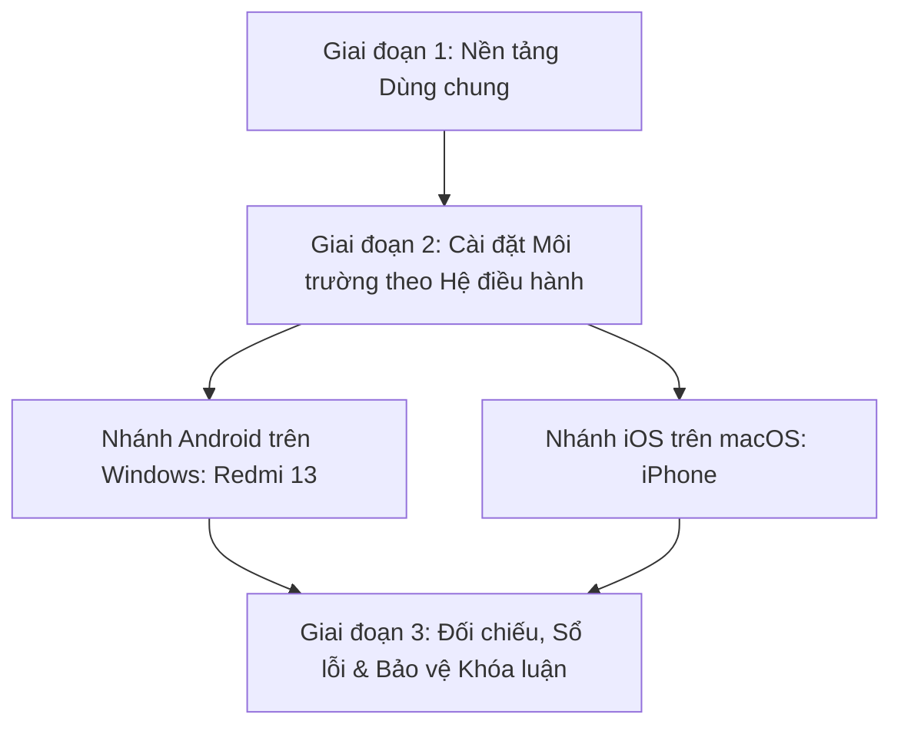

# BỘ GIÁO TRÌNH TỰ CODE LẠI LUNGCT TỪ ĐẦU CHO ANDROID VÀ IOS
### Hướng dẫn xây dựng ứng dụng di động hỗ trợ chẩn đoán ung thư phổi bằng Edge AI từ thư mục trống

> **Phiên bản tài liệu**: 1.1.0 (Bản thảo đang biên soạn - Chưa đạt mục tiêu >300 trang, chưa hướng dẫn trọn vẹn toàn bộ 121 tệp của app)  
> **Người thực hiện**:
> - **Phân hệ Android**: Dương Thị Thu Diễm (MSSV: 49.01.103.011)
> - **Phân hệ iOS**: Dương Hải Đăng (MSSV: 49.01.103.020)  
> **Giảng viên hướng dẫn**: ThS. Trịnh Huy Hoàng  
> **Đối tượng người học mục tiêu**: Người học đã nắm kiến thức C++ cơ bản và một ít Python; **chưa từng biết** JavaScript, TypeScript, React, React Native, Kotlin, Swift, SQL hay các công cụ build di động.
> **Hiện trạng**: Tài liệu Word/PDF xuất bản hiện tại đạt 68 trang (Android) và 55 trang (iOS), đóng vai trò bản thảo thực hành các mốc cốt lõi ban đầu và đang tiếp tục được bổ sung tuần tự song song với việc hoàn thiện ứng dụng.

---

## 🧭 1. NGƯỜI MỚI NÊN BẮT ĐẦU TỪ ĐÂU?

Nếu bạn mới bắt đầu từ con số 0, hãy tuân thủ lộ trình học 3 giai đoạn sau:

1. **Bước 1**: Đọc toàn bộ thư mục [`dung-chung/`](dung-chung/01-tu-duy-typescript-cho-nguoi-biet-cpp.md) để hiểu tư duy lập trình React Native từ góc nhìn của người biết C++ (ví dụ trực quan Thẻ rung gọi cà phê - Promise/Async/Await), hiểu kiến trúc luồng dữ liệu (State, Props) và cách tổ chức giao diện.
2. **Bước 2**: Tùy theo hệ điều hành máy tính bạn đang sử dụng:
   - **Nếu dùng máy tính Windows**: Đọc và thực hành theo thư mục [`android/`](android/README.md) (bắt đầu từ [Bài 1: Cài đặt môi trường Windows](android/01-cai-dat-moi-truong-windows.md)).
   - **Nếu dùng máy tính macOS**: Đọc và thực hành theo thư mục [`ios/`](ios/README.md) (bắt đầu từ [Bài 1: Cài đặt môi trường macOS](ios/01-cai-dat-moi-truong-macos.md)).
3. **Bước 3**: Đọc thư mục [`doi-chieu/`](doi-chieu/bang-so-sanh-android-ios.md) để đối chiếu sự khác biệt giữa hai hệ điều hành và thư mục [`tham-chieu/`](tham-chieu/thuat-ngu-va-cau-hoi-bao-ve.md) để chuẩn bị bộ câu hỏi bảo vệ trước Hội đồng chấm khóa luận.

---

## 🗺️ 2. PHÂN ĐỊNH PHẦN HỌC CHUNG VÀ THEO NỀN TẢNG

| Thành phần | Phạm vi | Mô tả chi tiết | Tệp bài học | Trạng thái bài học |
| :--- | :---: | :--- | :--- | :---: |
| **Kiến thức nền tảng** | Dùng chung | So sánh C++ với TypeScript; ví dụ Thẻ rung cà phê giải thích Promise, Async/Await; tư duy State/Props. | [`dung-chung/01-tu-duy-typescript-cho-nguoi-biet-cpp.md`](dung-chung/01-tu-duy-typescript-cho-nguoi-biet-cpp.md) | **Đã hoàn thiện bài học đầy đủ** |
| **Giao diện & Thành phần** | Dùng chung | Hệ thống Design System Tokens, Theme Sáng/Tối, 48 Icon y tế và 17 màn hình React Native. | `dung-chung/02-design-system-va-giao-dien.md` | Đang biên soạn |
| **Mô hình Dữ liệu** | Dùng chung | Entities, Repository Pattern, chính sách bảo vệ ca nháp khi bị khóa tài khoản (AUTH-08). | `dung-chung/03-mo-hinh-du-lieu-va-repository.md` | Đang biên soạn |
| **Môi trường Android** | Android | Cài đặt JDK 17, Android Studio, SDK 34, NDK, phân biệt compileSdk/minSdk/targetSdk, adb, máy ảo `LumaCT_Phone`, Redmi 13. | [`android/01-cai-dat-moi-truong-windows.md`](android/01-cai-dat-moi-truong-windows.md) | **Đã hoàn thiện bài học đầy đủ** |
| **Native AI & SQLCipher Android** | Android | Tích hợp ONNX Runtime + LiteRT qua C++/JNI, cấu hình SQLCipher 4.6.1 và Android Keystore. | `android/02-native-ai-va-sqlcipher.md` | Đang biên soạn |
| **Môi trường iOS** | iOS | Cài đặt Command Line Tools, Homebrew, Xcode 15/16, CocoaPods, Signing cá nhân và kết nối iPhone. | [`ios/01-cai-dat-moi-truong-macos.md`](ios/01-cai-dat-moi-truong-macos.md) | **Đã hoàn thiện bài học đầy đủ** (Chờ máy Mac) |
| **Khảo sát Edge AI iOS** | iOS | Khảo sát runtime AI trên iOS (CoreML vs ONNX Runtime iOS) và bảo mật Keychain Services. | `ios/02-khao-sat-ai-va-bao-mat-ios.md` | Đang biên soạn |
| **Bảng đối chiếu 2 nền tảng** | Đối chiếu | So sánh chi tiết từng bước, cấu trúc lệnh, thư viện và lỗi tương ứng giữa Android và iOS. | [`doi-chieu/bang-so-sanh-android-ios.md`](doi-chieu/bang-so-sanh-android-ios.md) | **Đã hoàn thiện tài liệu đối chiếu** |
| **Sổ lệnh & Sổ lỗi** | Tham chiếu | Cẩm nang dòng lệnh (PowerShell vs Bash), chẩn đoán lỗi thường gặp (Purity, MAX_PATH, Gradle bundle). | [`tham-chieu/so-lenh-va-so-loi.md`](tham-chieu/so-lenh-va-so-loi.md) | **Đã hoàn thiện sổ tra cứu** |
| **Thuật ngữ & Hỏi đáp bảo vệ** | Tham chiếu | Bảng thuật ngữ chuyên ngành và 4 câu hỏi bảo vệ khóa luận có căn cứ mã nguồn thực tế. | [`tham-chieu/thuat-ngu-va-cau-hoi-bao-ve.md`](tham-chieu/thuat-ngu-va-cau-hoi-bao-ve.md) | **Đã hoàn thiện cẩm nang bảo vệ** |

---

## 📊 3. BẢNG TIẾN ĐỘ VÀ TRẠNG THÁI KIỂM CHỨNG CHI TIẾT

> **Quy ước trạng thái minh bạch**:
> - `[Đã kiểm chứng thực tế]`: Đã thực hiện trên máy tính/thiết bị thực tế với mã nguồn thật, có log xác thực.
> - `[Đối chiếu tài liệu chính thức]`: Đã đối chiếu tài liệu chính thức của Apple/Google/React Native, chờ môi trường phần cứng để chạy xác minh.
> - `[Đang biên soạn tuần tự]`: Đang viết nội dung chi tiết theo đúng cấu trúc mẫu chuẩn.

| Mã bài | Tên bài học | Mục tiêu chính | Phân loại nội dung | Trạng thái kiểm chứng | Môi trường đã kiểm chứng |
| :---: | :--- | :--- | :---: | :---: | :--- |
| **DC-01** | Tư duy TypeScript & React Native cho người biết C++ | Thẻ rung gọi cà phê (Promise, async/await), kiểu dữ liệu cơ bản, State/Props | Bài hướng dẫn hoàn chỉnh | **Đã kiểm chứng thực tế** | Node.js 20.x / TypeScript compiler |
| **AND-01** | Thiết lập môi trường Android Studio & SDK trên Windows | Cài JDK 17, Android Studio, SDK 34, NDK, biến môi trường, máy ảo, Redmi 13 | Bài hướng dẫn hoàn chỉnh | **Đã kiểm chứng thực tế** | Windows 11 64-bit, Android Studio, AVD `LumaCT_Phone` |
| **IOS-01** | Thiết lập môi trường macOS & Xcode từ máy trắng | Cài Command Line Tools, Homebrew, Xcode, CocoaPods, Signing cá nhân 7 ngày | Bài hướng dẫn hoàn chỉnh | **Đối chiếu tài liệu chính thức** | Tài liệu Apple Developer & RN 0.88 (Chờ máy Mac) |
| **REF-01** | Sổ lệnh chạy, build, debug và sổ lỗi thực tế | Tra cứu nhanh lệnh PowerShell/Bash và cách xử lý lỗi Purity/Gradle/ADB | Sổ tay tra cứu hoàn chỉnh | **Đã kiểm chứng thực tế** | PowerShell 7 / Windows Terminal |
| **REF-02** | Thuật ngữ và Bộ câu hỏi bảo vệ khóa luận | Giải thích thuật ngữ chuyên ngành và trả lời chất vấn Hội đồng | Cẩm nang tra cứu hoàn chỉnh | **Đã đối chiếu mã nguồn** | Căn cứ mã nguồn thực tế LungCT |
| **COMP-01**| Bảng đối chiếu toàn diện Android vs iOS | So sánh kiến trúc, ngôn ngữ, công cụ, quản lý khóa và trạng thái triển khai | Bảng đối chiếu hoàn chỉnh | **Đã đối chiếu thực tế** | Phân hệ Android & iOS LungCT |
| **AND-02** | Tích hợp AI On-Device FP32 & SQLCipher Native | Tích hợp ONNX + LiteRT và SQLCipher 4.6.1 cấp trang | Đang biên soạn | Chờ biên soạn tuần tự | Mã native đã chạy đạt trên máy ảo API 34 |
| **AND-03** | Đóng gói và nghiệm thu trên Xiaomi Redmi 13 | Build APK Release độc lập, đo kiểm RAM và độ trễ chip Helio G91-Ultra | Đang biên soạn | Chờ thiết bị thật | Chờ kết nối Redmi 13 để đo kiểm |
| **IOS-02** | Khảo sát AI CoreML và Bảo vệ Khóa Keychain | Đối chiếu CoreML vs ONNX Runtime iOS, bảo mật Keychain | Đang biên soạn | Chờ khảo sát native | Bản thảo Khóa luận iOS 2026 |

---

## ⚠️ 4. NGUYÊN TẮC THỰC HÀNH BẢO VỆ DỰ ÁN GỐC

1. **Tuyệt đối không thực hành trực tiếp trong thư mục dự án gốc**: Toàn bộ bài tập tự gõ mã phải được thực hiện trong một thư mục thực hành riêng biệt (ví dụ: `C:\Practice_LungCT\`).
2. **Không tự ý cài đặt thư viện phiên bản mới nhất ("latest")**: Phải bám sát bảng phiên bản chuẩn đã kiểm chứng (React Native 0.88.0, ONNX Runtime 1.31.0 / 1.24.3, SQLCipher 4.6.1, Gradle 8.x).
3. **Mỗi bước đều có chốt kiểm tra (Checklist)**: Trước khi chuyển sang bài học tiếp theo, bắt buộc phải chạy lệnh kiểm tra và đạt kết quả mong đợi tương ứng.
